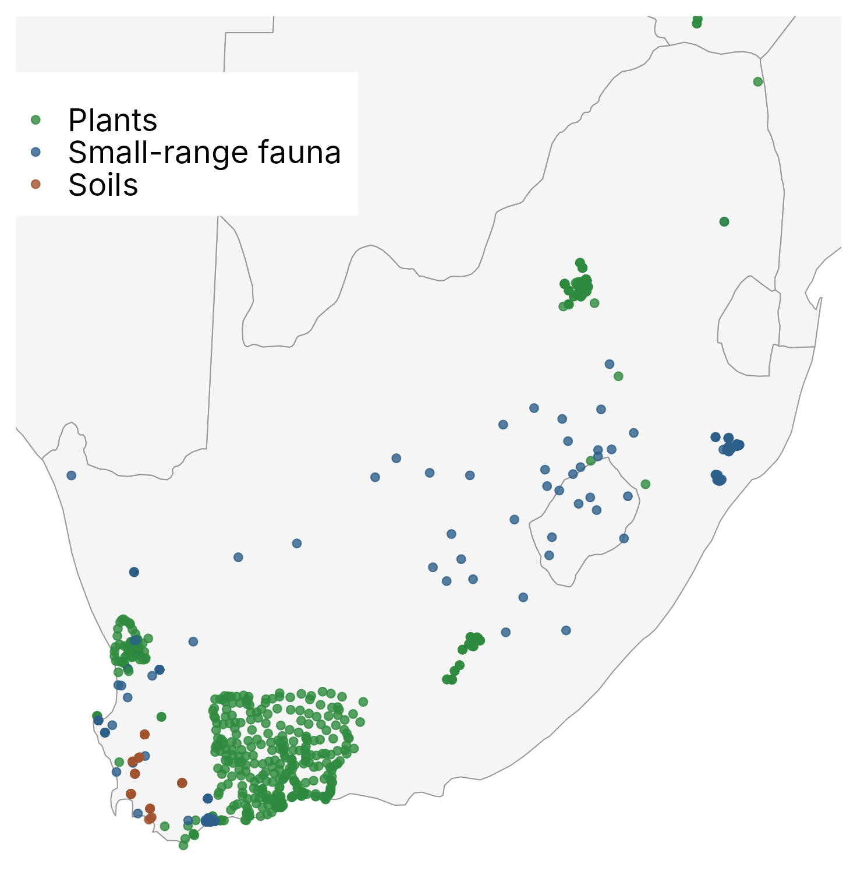

::: {.callout-note appearance="simple" icon="false"}
## In this section

-   **You'll learn:** what our training data contain, and what they mean for the isoscape we can build
-   **You'll need:** the `Module2_isoscape` folder ([Before the workshop](index.qmd#before-the-workshop))
-   **Time:** about 15 minutes
:::

## Overview

This script is adapted from Bataille et al. (2020), "Advances in global bioavailable strontium isoscapes". This version uses **South Africa** as a case study. Compared with the global version:

1.  **Training data:** a harmonised and screened dataset of bioavailable ⁸⁷Sr/⁸⁶Sr in the ARDUOUS format (prepared in Module 1), mostly from plants.
2.  **Covariates:** the global Eckert IV 1 km rasters are already clipped to South Africa, so no cropping is needed and everything runs on a laptop.
3.  **New regional covariates:** African soil chemistry (iSDA Africa), the 1:1M geological map of South Africa, the South African vegetation map, and neighbourhood (5, 10, 25 km) means of the bedrock ⁸⁷Sr/⁸⁶Sr and geological age.
4.  **Spatial cross-validation:** we compare random and spatial-block cross-validation, and use the spatial one to prune the predictors and tune the model.

::: {.callout-tip icon="false"}
## More resources

-   Bataille, C. P., Crowley, B. E., Wooller, M. J., & Bowen, G. J. (2020). Advances in global bioavailable strontium isoscapes. *Palaeogeography, Palaeoclimatology, Palaeoecology*, 555, 109849. <https://doi.org/10.1016/j.palaeo.2020.109849>
-   Global predictor rasters: <https://osf.io/a2r7g/>
:::

## Setting up

```{r}
#| label: setup
# install if necessary
list.of.packages <- c("terra", "sf", "rnaturalearth", "rnaturalearthdata", "caret", "VSURF", "ranger", "corrplot", "viridis", "patchwork", "ggplot2", "pdp")

new.packages <- list.of.packages[!(list.of.packages %in% installed.packages()[,"Package"])]

if(length(new.packages)) install.packages(new.packages)

  library(parallel)    # detectCores() (part of base R)
  library(terra)
  library(sf)
  library(viridis)
  library(rnaturalearth)
  library(rnaturalearthdata)
  library(caret)
  library(VSURF)
  library(ranger)
  library(corrplot)
  library(patchwork)
  library(ggplot2)
  library(pdp)
  library(tidyverse)

# Number of cores used by VSURF (ranger uses all the cores by itself)
n_cores <- max(detectCores() - 1, 1)  # convention to leave 1 core for OS

# caret runs sequentially here (ranger is already multi-threaded). If a parallel
# cluster is still registered from a previous session (e.g. registerDoParallel()),
# caret would try to use it and fail with "invalid connection": reset it.
foreach::registerDoSEQ()
```

```{r}
#| label: folders
#!! Create or use sub folders to keep things tidy!
mydir <- getwd()

dir.create(file.path(mydir, "/Output", fsep = .Platform$file.sep), showWarnings = FALSE)

# Folder with the rasters clipped to South Africa (Eckert IV, 1 km)
# If you have only the zip file, run the commented line below to unzip it
# unzip("Project_Raster.zip", exdir = "Project_Raster")
raster_dir <- "Project_Raster/clipped_za"

# Projection used for everything in this script (Eckert IV, equal area, metres)
eck4 <- "+proj=eck4 +lon_0=0 +x_0=0 +y_0=0 +ellps=WGS84 +units=m +no_defs"
```

## Step 1.1: Import the training data

The training dataset `Data/SouthAfrica_bioavailable_Sr_ARDUOUS.csv` has already been harmonised and screened for you (this is what we did in Module 1 with the ARDUOUS template).

**This dataset mostly represents bioavailable ⁸⁷Sr/⁸⁶Sr from plants** (608 of 927 records, 66%), complemented by modern fauna with small home ranges (259 records, 28%: rodents, hyraxes, hares, snails, tortoises, small antelopes) and soil leachates (60 records, 6%). It includes 579 distinct sampling locations.

::: {.callout-note collapse="true"}
## Screening applied

-   only records within South Africa, with coordinates and 0.700 \< ⁸⁷Sr/⁸⁶Sr \< 0.800;
-   waters (rivers, groundwater) removed, because they integrate whole catchments;
-   humans, hominins, primates, elephants and ivory, domestic cattle, fish, birds, large and migratory herbivores and large carnivores removed, because their ⁸⁷Sr/⁸⁶Sr does not reflect where they were collected;
-   fossil specimens removed (e.g. the Elandsfontein and Sterkfontein/Swartkrans fossil fauna);
-   duplicated measurements present in both compilations removed.
:::

```{r}
#| label: import
#Import training data: harmonised and screened bioavailable 87Sr/86Sr dataset for South Africa (ARDUOUS format)
#Mostly bioavailable Sr data from plants (66%), plus small-home-range fauna (28%) and soils (6%)
# read.csv() renames the ARDUOUS column "87Sr86Sr" to "X87Sr86Sr" (R names cannot start with a number)
sr_orig <- read.csv("Data/SouthAfrica_bioavailable_Sr_ARDUOUS.csv")

nrow(sr_orig)
table(sr_orig$material_type)
summary(sr_orig$X87Sr86Sr)
```

## Step 1.2: Project the data into Eckert IV

We will use the Eckert IV equal-area projection (1 km pixels) for everything.

```{r}
#| label: project
sr_proj <- st_as_sf(sr_orig, coords = c("collection_decimal_longitude", "collection_decimal_latitude"), crs = st_crs(4326), remove = FALSE) %>%
  st_transform(crs = eck4)
plot(sr_proj["X87Sr86Sr"], pch = 16, cex = 0.6)
```

{width="70%"}

## Step 1.3: Administrative maps

Country boundaries for the figures, from Natural Earth, reprojected into Eckert IV.

```{r}
#| label: admin-maps
world <- ne_countries(scale = "medium", returnclass = "sf")
world_p <- st_as_sf(world, crs = st_crs(4326)) %>%
  st_transform(crs = eck4)
# Keep South Africa and neighbouring countries for the figures
za_p <- world_p[world_p$admin %in% c("South Africa", "Lesotho", "eSwatini", "Swaziland", "Namibia", "Botswana", "Zimbabwe", "Mozambique"),]
plot(st_geometry(za_p))
```

::::::: think-pair-share
### 🦋 Think · Pair · Share: a map for a butterfly

You want to find where painted ladies (*Vanessa cardui*) caught in South Africa grew up, from the ⁸⁷Sr/⁸⁶Sr of their wings. **What training data and what kind of bioavailable Sr map do you need?**

:::::: tps-steps
::: tps-step
**💭 Think** [2 min]{.tps-time}

```{r}
#| label: tps-material
table(sr_orig$material_type)
```

On your own, look at the sample types and the map above.

-   Where does a butterfly's wing Sr come from?
-   When in its life is it fixed?
:::

::: tps-step
**🤝 Pair** [3 min]{.tps-time}

With your neighbour:

-   Which substrate is the best analogue for a butterfly: soils, plants or small-range fauna?
-   Which records would you keep or drop?
-   Is the spatial coverage good enough where your butterflies might come from?
:::

::: tps-step
**📣 Share** [3 min]{.tps-time}

Tell the room what map you would build:

-   All substrates or plants only?
-   Over what extent, at what resolution, and with what uncertainty?
:::
::::::
:::::::

::: {.callout-caution collapse="true"}
## Things you might have noticed

**🌿 The best substrate**

-   Wing Sr is fixed during the **larval stage**: caterpillars eat host-plant leaves, and adult wing chitin is not remodelled.
-   Herbaceous host plants (thistles, mallows, other Asteraceae) are the closest analogue: shallow roots, same Sr pool.
-   Soil leachates, deep-rooted trees and small mammals sample other Sr pools or larger areas, and can be offset from host plants.

**🗺️ The map you need**

-   A plant-based (or plant-dominated) bioavailable Sr isoscape. Try it in [Exercise 1](06-isoscape.qmd#exercises).
-   An extent covering the whole potential natal range. Painted ladies may come from beyond South Africa (Namibia, Botswana, Zimbabwe…).
-   A resolution matching the larval home range (~1 km is fine for a caterpillar).
-   A pixel-level uncertainty (SD) to feed `assignR::pdRaster()` in Module 3.

**⚠️ Watch out**

-   579 sites, but most are in the south-western Cape: the interior (Karoo, Northern Cape, Limpopo) will be predicted from covariates, not data.
-   Mixing substrates adds variance: part of the "model error" is a substrate offset.

**Take-home:** match the isoscape to the organism: the same Sr pool, the same spatial scale, and an extent as large as the question.
:::

## Summary

::: {.callout-note appearance="simple"}
## Key takeaways

-   The training data are screened, harmonised bioavailable ⁸⁷Sr/⁸⁶Sr: mostly plants, plus small-range fauna and soils.
-   The sites are strongly clustered in the south-western Cape. Keep this in mind when we evaluate the model.
-   The best isoscape depends on the organism you want to track.
:::

# **Next:** [2. Covariates →](02-covariates.qmd)
