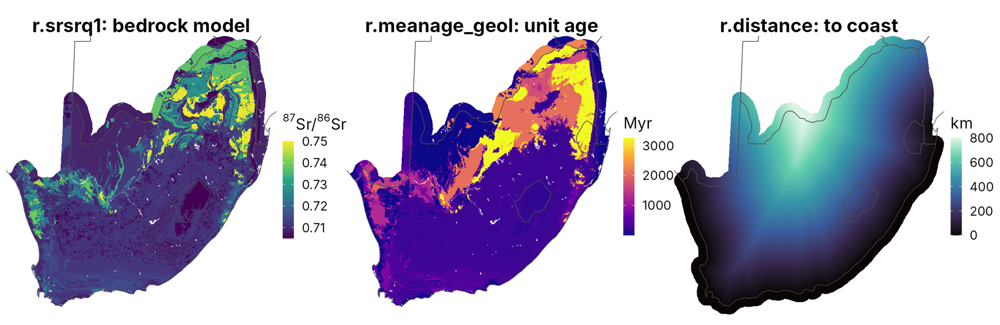
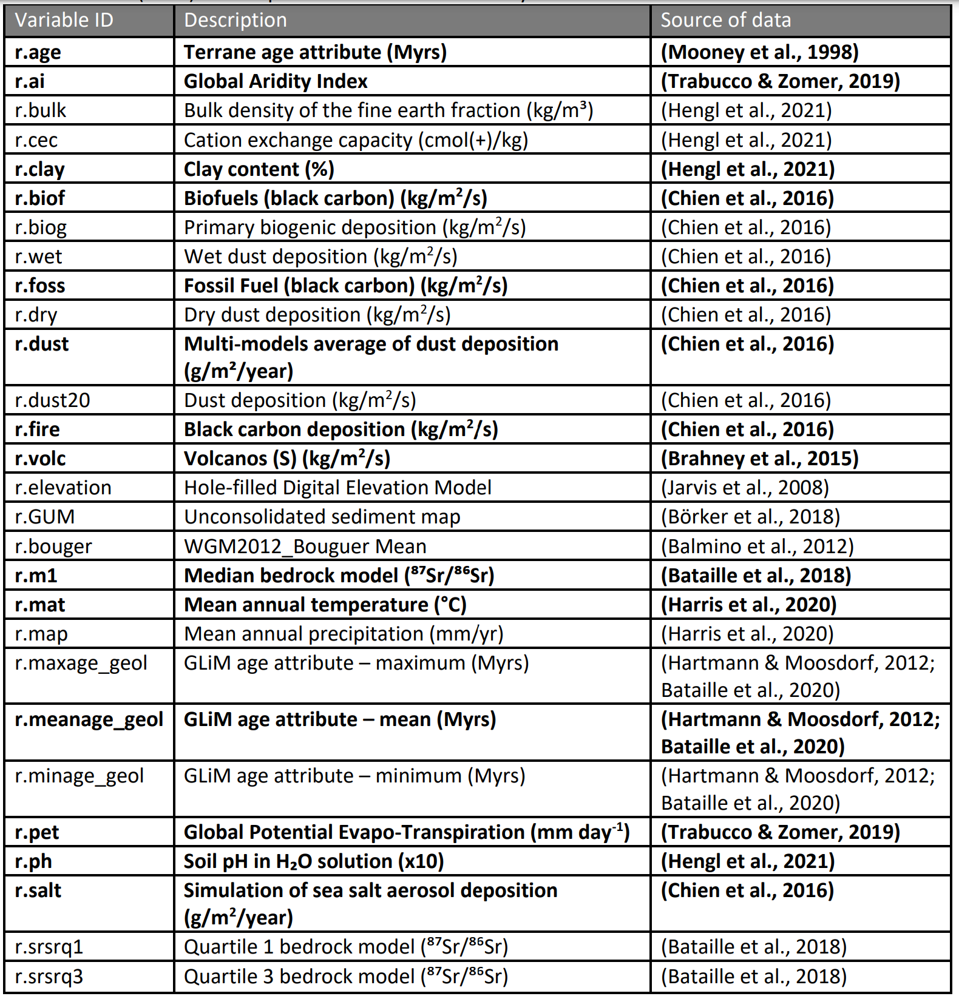
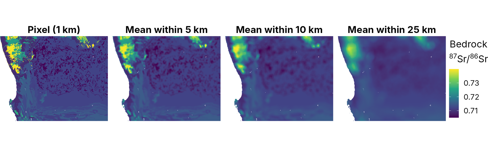

::: {.callout-note appearance="simple" icon="false"}
## In this section

-   **You'll learn:** which covariates can predict bioavailable ⁸⁷Sr/⁸⁶Sr, and why
-   **You'll need:** `Project_Raster/clipped_za/`
-   **Time:** about 20 minutes
:::

## Overview

We now load the covariates used to train the random forest. They describe the geological, environmental and climatic processes that control bioavailable ⁸⁷Sr/⁸⁶Sr: the **sources** of Sr (bedrock, dust, sea salt), how it is **mixed and weathered** (soils, climate, sediments) and how it is **taken up** (vegetation).

::: callout-warning
## Same projection, same grid

The rasters must share the same projection and resolution, and be snapped to each other. This preprocessing is slow for global layers, so it has been done for you: the global Eckert IV 1 km rasters ([OSF](https://osf.io/a2r7g/)) are already clipped to South Africa in `Project_Raster/clipped_za`.

Want to build an isoscape for **your own study area**? See the extra page [Your own study area](02b-own-study-area.qmd) (not run during the workshop).
:::



::: {.callout-note collapse="true"}
## The full list of global covariates

{width="80%"}

Compared with the global script, a few global layers are not in the South Africa set (Bouguer anomaly, permafrost, mean annual temperature and the other WorldClim variables except wind). Permafrost is irrelevant in South Africa anyway!
:::

## Step 2.2: Geological variables

```{r}
#| label: geology
#| code-fold: true
#| code-summary: "Show the code"
###Global median, Q1 and Q3 bedrock model 87Sr/86Sr (Bataille et al. 2020)
###(in this clipped set, r.m1 is identical to r.srsrq1)

r.m1 <- terra::rast(file.path(raster_dir, "r.m1.tif"))
r.srsrq1 <- terra::rast(file.path(raster_dir, "r.srsrq1.tif"))
r.srsrq3 <- terra::rast(file.path(raster_dir, "r.srsrq3.tif"))

###Global mean, min and max geological age in Myrs from the GLiM Hartman and Moosdorf 2012 and Bataille et al. 2020 for text to numerica age field converstion

r.meanage_geol <- terra::rast(file.path(raster_dir, "r.meanage_geol.tif"))
r.minage_geol <- terra::rast(file.path(raster_dir, "r.minage_geol.tif"))
r.maxage_geol <- terra::rast(file.path(raster_dir, "r.maxage_geol.tif"))

###Global mean of terrane age in Myrs (Mooney et al. 1988)

r.age <- terra::rast(file.path(raster_dir, "r.age.tif"))

###Global unconsolidated sediments type (see publications for each class) (Börker et al., 2018)

r.GUM <- terra::rast(file.path(raster_dir, "r.GUM.tif"))

###Global elevation in m ((Jarvis et al., 2008) )
r.elevation <- terra::rast(file.path(raster_dir, "r.elevation.tif"))

###NEW (regional) - Geological map of South Africa 1:1 000 000 (Council for Geoscience)
###Categorical: each value is a lithostratigraphic unit (field UQ_SACS_NO of the attribute table)
r.geomap <- terra::rast(file.path(raster_dir, "r.geomap.tif"))
```

## Step 2.3: Climate variables

```{r}
#| label: climate
#| code-fold: true
#| code-summary: "Show the code"
### Mean annual precipitation (mm/yr) (Harris et al., 2020)

r.map <- terra::rast(file.path(raster_dir, "r.map.tif"))

###Global Aridity Index Aridity Index <-  Mean annual precipitation÷ Mean annual evapotranspiration (Trabuco & Zomer, 2019)

r.ai <- terra::rast(file.path(raster_dir, "r.ai.tif"))

### Global Potential Evapo-Transpiration (mm day-1) (Trabuco & Zomer, 2019)
r.pet <- terra::rast(file.path(raster_dir, "r.pet.tif"))

### Potential evapotranspiration, climatology version (mm/yr) [CHECK REFERENCE - not in the global script]
r.pet_clim <- terra::rast(file.path(raster_dir, "r.pet_clim.tif"))

###World clim data (wind speed, m/s)

r.wind  <- terra::rast(file.path(raster_dir, "r.wind.tif"))
```

## Step 2.4: Atmospheric deposition variables

::: callout-warning
## Coarse layers

These layers come from global atmospheric models with a coarse resolution (~1 to 2 degrees). They have been resampled to 1 km but, inside a single country, they are smooth gradients (you can see the large "blocks" if you plot them). We will come back to this in [Step 3.5](03-regression-matrix.qmd#step-3.5-choose-the-candidate-covariates).
:::

```{r}
#| label: deposition
#| code-fold: true
#| code-summary: "Show the code"
###Multi-models average of dust deposition (g/m²/year) (Chien et al., 2016; Brahney et al., 2015)

r.dust <- terra::rast(file.path(raster_dir, "r.dust.tif"))

###Simulation of sea salt aerosol deposition (g/m2/year) (Chien et al., 2016)

r.salt <- terra::rast(file.path(raster_dir, "r.salt.tif"))

###Simulation of distance (distance to the coastline)

r.distance <- terra::rast(file.path(raster_dir, "r.distance.tif"))

###Volcanos (S) (kg/m2/s) (Brahney et al., 2015)

r.volc <- terra::rast(file.path(raster_dir, "r.volc.tif"))

###Black carbon deposition (kg/m2/s) (Chien et al., 2016)

r.fire <- terra::rast(file.path(raster_dir, "r.fire.tif"))

### Fossil Fuel (Black Carbon) (kg/m2/s) (Chien et al., 2016)
r.foss <- terra::rast(file.path(raster_dir, "r.foss.tif"))

### Biofuel and primary biogenic particle deposition (kg/m2/s) [CHECK REFERENCE - not in the global script; presumably same model set as above (Chien et al., 2016)]
r.biofuels <- terra::rast(file.path(raster_dir, "r.biofuels.tif"))
r.biogenic <- terra::rast(file.path(raster_dir, "r.biogenic.tif"))
```

## Step 2.5: Soil properties

```{r}
#| label: soils
#| code-fold: true
#| code-summary: "Show the code"
### Downloaded from SoilGrids for 5cm to 15cm soil depth include

###Clay fraction (%), ph, Cation Exchange Capacity (cmol+ /kg) , bulk density, organic carbon content (Hengl et al., 2021)
r.clay <- terra::rast(file.path(raster_dir, "r.clay.tif"))
r.ph <- terra::rast(file.path(raster_dir, "r.ph.tif"))
r.cec <- terra::rast(file.path(raster_dir, "r.cec.tif"))
r.bulk <- terra::rast(file.path(raster_dir, "r.bulk.tif"))
r.ocs <- terra::rast(file.path(raster_dir, "r.ocs.tif"))
r.w0033 <- terra::rast(file.path(raster_dir, "r.w0033.tif"))
r.w1500 <- terra::rast(file.path(raster_dir, "r.w1500.tif"))
r.w0010_30 <- terra::rast(file.path(raster_dir, "r.w0010_30.tif"))

###Soil organic content, organic carbon density and nitrogen content between 5-15cm in soil (Hengl et al., 2023)

r.soc <- terra::rast(file.path(raster_dir, "r.soc.tif"))
r.ocd <- terra::rast(file.path(raster_dir, "r.ocd.tif"))
r.nitrogen <- terra::rast(file.path(raster_dir, "r.nitrogen.tif"))

###Global soil moisture map(Guevara et al., 2020)
r.sw <- terra::rast(file.path(raster_dir, "r.sw.tif"))

###Global wetland(Fluet-Chouinard et al., 2023)
r.wetland <- terra::rast(file.path(raster_dir, "r.wetland.tif"))

### Phosphorus fertilizer application [CHECK REFERENCE - not in the global script]
r.pfert <- terra::rast(file.path(raster_dir, "r.pfert.tif"))
```

## Step 2.6: African soil chemistry (NEW, regional)

iSDA Africa soil maps, originally at 30 m and aggregated to 1 km (Hengl et al., 2021, *Scientific Reports* 11: 6130). Two depths: `.0` = 0–20 cm and `.20` = 20–50 cm. Extractable elements are in ppm (Mehlich-3 extraction); eCEC = effective cation exchange capacity (cmol+/kg); texture = USDA texture class.

```{r}
#| label: isda
#| code-fold: true
#| code-summary: "Show the code"
###Extractable Ca, Mg, K (major cations of the exchange complex, controls on Sr)
r.africa.Ca.0 <- terra::rast(file.path(raster_dir, "r.africa.Ca.0.tif"))
r.africa.Ca.20 <- terra::rast(file.path(raster_dir, "r.africa.Ca.20.tif"))
r.africa.Mg.0 <- terra::rast(file.path(raster_dir, "r.africa.Mg.0.tif"))
r.africa.Mg.20 <- terra::rast(file.path(raster_dir, "r.africa.Mg.20.tif"))
r.africa.K.0 <- terra::rast(file.path(raster_dir, "r.africa.K.0.tif"))
r.africa.K.20 <- terra::rast(file.path(raster_dir, "r.africa.K.20.tif"))

###Extractable Al, Fe (weathering intensity), P, S, Zn
r.africa.Al.0 <- terra::rast(file.path(raster_dir, "r.africa.Al.0.tif"))
r.africa.Al.20 <- terra::rast(file.path(raster_dir, "r.africa.Al.20.tif"))
r.africa.Fe.0 <- terra::rast(file.path(raster_dir, "r.africa.Fe.0.tif"))
r.africa.Fe.20 <- terra::rast(file.path(raster_dir, "r.africa.Fe.20.tif"))
r.africa.P.0 <- terra::rast(file.path(raster_dir, "r.africa.P.0.tif"))
r.africa.P.20 <- terra::rast(file.path(raster_dir, "r.africa.P.20.tif"))
r.africa.S.0 <- terra::rast(file.path(raster_dir, "r.africa.S.0.tif"))
r.africa.S.20 <- terra::rast(file.path(raster_dir, "r.africa.S.20.tif"))
r.africa.Zn.0 <- terra::rast(file.path(raster_dir, "r.africa.Zn.0.tif"))
r.africa.Zn.20 <- terra::rast(file.path(raster_dir, "r.africa.Zn.20.tif"))

###Effective cation exchange capacity
r.africa.eCEC.0 <- terra::rast(file.path(raster_dir, "r.africa.eCEC.0.tif"))
r.africa.eCEC.20 <- terra::rast(file.path(raster_dir, "r.africa.eCEC.20.tif"))

###Sand, silt and texture class
r.africa.sand.0 <- terra::rast(file.path(raster_dir, "r.africa.sand.0.tif"))
r.africa.sand.20 <- terra::rast(file.path(raster_dir, "r.africa.sand.20.tif"))
r.africa.silt.0 <- terra::rast(file.path(raster_dir, "r.africa.silt.0.tif"))
r.africa.silt.20 <- terra::rast(file.path(raster_dir, "r.africa.silt.20.tif"))
r.africa.texture.0 <- terra::rast(file.path(raster_dir, "r.africa.texture.0.tif"))
r.africa.texture.20 <- terra::rast(file.path(raster_dir, "r.africa.texture.20.tif"))
```

## Step 2.7: Vegetation (NEW, regional)

```{r}
#| label: vegmap
###Vegetation map of South Africa, Lesotho and Swaziland (Mucina & Rutherford, 2006; SANBI VegMap)
###Categorical: each value is a vegetation unit (field T_Name of the attribute table)
r.vegmap <- terra::rast(file.path(raster_dir, "r.vegmap.tif"))
```

## Step 2.8: Neighbourhood geology (NEW)

The bedrock ⁸⁷Sr/⁸⁶Sr model (`r.srsrq1`) and the age of the geological units (`r.meanage_geol`) describe the rock **directly under each 1 km pixel**, with sharp boundaries between units. But bioavailable Sr at a site does not come only from the rock under it:

-   soils form on sediments, colluvium and alluvium transported from the surrounding hills;
-   dust and runoff mix material from the surrounding area;
-   plants and animals integrate Sr over their root zone or home range;
-   the sample coordinates and the geological contacts both have location errors of hundreds of metres to kilometres.

To represent this, we compute the **mean of the bedrock ⁸⁷Sr/⁸⁶Sr and of the geological age within circles of 5, 10 and 25 km** around each pixel (a moving-window or "focal" mean). The random forest can then learn at which scale the geology best predicts bioavailable ⁸⁷Sr/⁸⁶Sr.

```{r}
#| label: focal
focal_dir <- "Project_Raster/neighbourhood"
dir.create(focal_dir, showWarnings = FALSE)

focal_names <- c()
for (v in c("r.srsrq1", "r.meanage_geol")) {
  for (km in c(5, 10, 25)) {
    name <- sprintf("%s.f%02d", v, km)               # e.g. r.srsrq1.f05 = mean within 5 km
    file <- file.path(focal_dir, paste0(name, ".tif"))
    if (!file.exists(file)) {
      r <- get(v)
      w <- focalMat(r, km * 1000, type = "circle")   # circular window, radius in metres
      w[w > 0] <- 1                                   # simple (unweighted) mean
      f <- focal(r, w = w, fun = "mean", na.rm = TRUE)
      f <- mask(f, r)                                 # keep the land mask of the original raster
      writeRaster(f, file, overwrite = TRUE)
    }
    assign(name, terra::rast(file))
    focal_names <- c(focal_names, name)
  }
}
focal_names
plot(c(r.srsrq1, r.srsrq1.f05, r.srsrq1.f10, r.srsrq1.f25), nc = 4)
```



::: callout-tip
## Why stop at 25 km?

In the training data, adding these six layers improves the spatial cross-validation R² from ~0.5 to ~0.7. Going beyond 25 km does not help: at 50 km the layers become so smooth that they behave like coordinates.
:::

## Step 2.9: Put all covariates in a stack

Instead of handling each raster separately, we store all of them in a single stack. `predictor_names` is the list of all the covariates we just loaded.

```{r}
#| label: stack
predictor_names <- c("r.m1", "r.srsrq1", "r.srsrq3",
                     "r.meanage_geol", "r.minage_geol", "r.maxage_geol",
                     "r.age", "r.GUM", "r.elevation", "r.geomap",
                     "r.map", "r.ai", "r.pet", "r.pet_clim", "r.wind",
                     "r.dust", "r.salt", "r.distance", "r.volc", "r.fire", "r.foss", "r.biofuels", "r.biogenic",
                     "r.clay", "r.ph", "r.cec", "r.bulk", "r.ocs", "r.w0033", "r.w1500", "r.w0010_30",
                     "r.soc", "r.ocd", "r.nitrogen", "r.sw", "r.wetland", 
                     "r.africa.Ca.0", "r.africa.Ca.20", "r.africa.Mg.0", "r.africa.Mg.20",
                     "r.africa.K.0", "r.africa.K.20", "r.africa.Al.0", "r.africa.Al.20",
                     "r.africa.Fe.0", "r.africa.Fe.20", "r.africa.P.0", "r.africa.P.20",
                     "r.africa.S.0", "r.africa.S.20", "r.africa.Zn.0", "r.africa.Zn.20",
                     "r.africa.eCEC.0", "r.africa.eCEC.20",
                     "r.africa.sand.0", "r.africa.sand.20", "r.africa.silt.0", "r.africa.silt.20",
                     "r.africa.texture.0", "r.africa.texture.20",
                     "r.vegmap",
                     focal_names)

# Convert character names to actual objects dynamically and combine into a single SpatRaster
stack_all <- do.call(c, lapply(predictor_names, get))
names(stack_all) <- predictor_names

# The two categorical maps come with an attribute table (unit names). For the
# regression matrix we only need the numeric code of each class, so we drop the
# attribute table (otherwise the unit names, with spaces and apostrophes, end up
# in the table and break the median aggregation)
for (p in c("r.geomap", "r.vegmap")) levels(stack_all[[p]]) <- NULL

# Have a look at some of them
plot(stack_all[[c("r.srsrq1", "r.meanage_geol", "r.distance", "r.map", "r.dust", "r.africa.Ca.0")]])
```

::::::: think-pair-share
### Think · Pair · Share: covariates for South Africa

The script loads ~60 rasters: global layers we use everywhere, plus layers that only exist here. **Which covariates help in South Africa that we don't have anywhere else?**

:::::: tps-steps
::: tps-step
**💭 Think** [2 min]{.tps-time}

```{r}
#| label: tps-covariates
plot(stack_all[[c("r.srsrq1", "r.distance", "r.africa.Ca.0", "r.vegmap")]])
```

On your own, scroll through Steps 2.2–2.8 and list every covariate marked NEW (regional).
:::

::: tps-step
**🤝 Pair** [3 min]{.tps-time}

With your neighbour, for each regional covariate:

-   Which part of the Sr cycle does it describe: source rock, weathering, atmospheric input or plant uptake?
-   Do you expect the model to pick it? Could it cause trouble?
:::

::: tps-step
**📣 Share** [3 min]{.tps-time}

Think about your own isoscape:

-   Which covariates would you use, and why?
-   Which regional datasets exist for your study area?
:::
::::::
:::::::

::: {.callout-caution collapse="true"}
## Things you might have noticed

**🧭 Only in this South African model**

-   The 1:1M geological map (Council for Geoscience): `r.geomap`
-   iSDA Africa soil chemistry: extractable Ca, Mg, K, Al, Fe, P, S, Zn, eCEC and texture at 0–20 and 20–50 cm
-   The SANBI vegetation map (Mucina & Rutherford 2006): `r.vegmap`
-   Neighbourhood geology: mean bedrock ⁸⁷Sr/⁸⁶Sr and age within 5, 10 and 25 km. Spatial CV R² goes from ~0.5 to ~0.7

**🔬 Link each one to a process**

-   Extractable Ca, Mg: the exchangeable pool plants draw from; carbonate, calcrete and shell input
-   Al, Fe: weathering intensity. Texture: transport and mixing of sediments
-   Vegetation: climate, rooting depth, biome

**⚠️ Not every new layer helps**

-   Categorical maps with hundreds of classes: most classes contain no training site, so they are dropped in [Step 3.5](03-regression-matrix.qmd#step-3.5-choose-the-candidate-covariates).
-   The coarse aerosol models (~1–2°) behave like coordinates inside one country.
-   `r.africa.Ca.0` made it into the final model; the categorical maps did not.

**🧰 For your own isoscape**

-   Choose by process (source × mixing × uptake), not by availability.
-   Match the resolution to your sampling scale, and cover the whole prediction area.
-   Look for regional data: detailed geological maps, airborne radiometric surveys (K, Th, U), soil geochemistry, loess and till maps.

**Take-home:** a regional covariate is worth adding only if it encodes a Sr process and your training sites sample its range.
:::

## Summary

::: {.callout-note appearance="simple"}
## Key takeaways

-   Covariates describe the sources, mixing and uptake of Sr.
-   Regional datasets (soil chemistry, detailed geology) can add real information, but only if the training sites cover them.
-   Bioavailable Sr integrates more than the rock under the pixel: neighbourhood geology captures this.
-   To work in another area, clip the global OSF rasters to your study area: see [Your own study area](02b-own-study-area.qmd).
:::

**Extra (optional, after the workshop):** [Applying this to your own study area](02b-own-study-area.qmd)

# **Next:** [3. Regression matrix →](03-regression-matrix.qmd)
