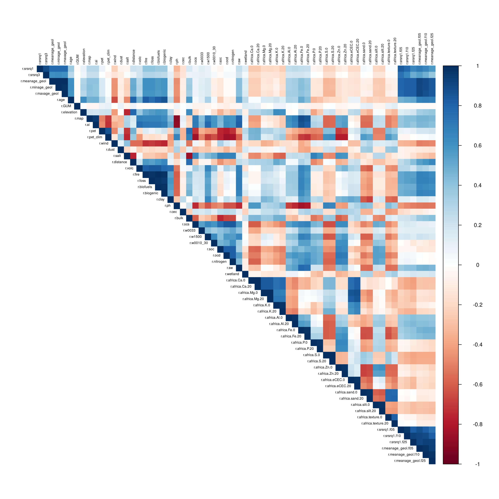

::: {.callout-note appearance="simple" icon="false"}
## In this section

-   **You'll learn:** how to build a clean regression matrix, and what correlated covariates do to a random forest
-   **You'll need:** `sr_proj` (Section 1) and `stack_all` (Section 2)
-   **Time:** about 30 minutes
:::

## Overview

We now have a training set (sites with ⁸⁷Sr/⁸⁶Sr in Eckert IV) and covariates in the same projection. We overlay the sites on the maps, extract the value of every covariate under each site, and assemble everything into one **regression matrix**: one row per site, one column per covariate.

## Step 3.1: Extract

::: callout-warning
## Sites on a nodata pixel

Some sites fall on a pixel with no value, often around coastlines, rivers and lakes. To avoid losing them, the function below takes the value of the nearest non-NA pixel within 5 km.
:::

```{r}
#| label: extract-function
#| code-fold: true
#| code-summary: "Show the extraction function"
# Extract the values of all layers under the points; for points falling on a NA
# pixel, take the nearest non-NA pixel within max_dist (in map units, here metres)
extract_nearest_non_na <- function(points, r, max_dist = 5000) {
  v <- terra::extract(r, vect(points), ID = FALSE)
  xy <- st_coordinates(points)
  for (i in which(!complete.cases(v))) {
    # small window of rasters around the point
    rr <- crop(r, ext(xy[i, 1] - max_dist, xy[i, 1] + max_dist, xy[i, 2] - max_dist, xy[i, 2] + max_dist))
    vals <- values(rr)
    cxy <- xyFromCell(rr, 1:ncell(rr))
    d <- sqrt((cxy[, 1] - xy[i, 1])^2 + (cxy[, 2] - xy[i, 2])^2)
    # for each layer with a NA, take the value of the nearest non-NA pixel
    for (j in which(is.na(v[i, ]))) {
      ok <- !is.na(vals[, j])
      if (any(ok)) v[i, j] <- vals[ok, j][which.min(d[ok])]
    }
  }
  v
}
```

```{r}
#| label: extract
# For each covariate extract values under points (all covariates at once)
s_proj <- sr_proj
extracted <- extract_nearest_non_na(s_proj, stack_all)

# Number of points that still have NA (no valid pixel within 5 km)
sum(!complete.cases(extracted))

s_xy <- data.frame(st_coordinates(s_proj))
```

## Step 3.2: Amalgamate into a regression matrix

```{r}
#| label: regression-matrix
### Create the regression matrix. Append all extracted data and change names of column

s_proj_xy <- data.frame(Latitude = s_proj$collection_decimal_latitude,
                        Longitude = s_proj$collection_decimal_longitude,
                        X87Sr86Sr = s_proj$X87Sr86Sr,
                        s_xy,
                        as.data.frame(extracted))

# the column names are the names of the covariates ("r.m1", "r.srsrq1", ...)
colnames(s_proj_xy) <- c("Latitude", "Longitude", "X87Sr86Sr", "X", "Y", predictor_names)
```

```{r}
#| label: save-matrix
#Save table into directory for future use
write.table(s_proj_xy, "Output/sr_proj_xy_all.txt", sep = "\t",col.names = T, row.names = F, quote = F)
```

## Step 3.3: Save and reload

If you want to skip the extraction (Step 3.1), you can directly load the table.

```{r}
#| label: reload-matrix
# Load table from previous chunk
sr_proj_xy <- read.table("Output/sr_proj_xy_all.txt", sep = "\t", h = T)
```

## Step 3.4: Clean the regression matrix

-   **Remove NA rows.** There shouldn't be many, thanks to the nearest-pixel extraction.
-   **Handle outliers.** Random forest predictions are not sensitive to outliers, but performance metrics can be. As in the global dataset, we remove values \> 0.8.
-   **One value per site.** Several samples at the same site are not independent, so we aggregate them with the median.

```{r}
#| label: clean
# remove NA values cases if any from the dataset
sr_proj_xy <- sr_proj_xy[!is.na(sr_proj_xy$r.srsrq1),]

# Optional. Filter 'sr_proj_xy' to exclude rows with super high or zero values
sr_proj_xy1 <- sr_proj_xy[sr_proj_xy$X87Sr86Sr <= 0.8, ]
sr_proj_xy2 <- sr_proj_xy1[!(sr_proj_xy1$X87Sr86Sr == 0), ]

#Aggregate all samples by latitude and longitude to avoid having multiple samples per site
#(the categorical maps, r.geomap and r.vegmap, are aggregated with the median too; this is fine
# because all samples of one site fall in the same class)
sr_agg1 <- aggregate(sr_proj_xy2, by = list(sr_proj_xy2$Latitude, sr_proj_xy2$Longitude), FUN = median, na.rm = TRUE)
sr_agg1 <- sr_agg1[,3:ncol(sr_agg1)]   # remove the two grouping columns added by aggregate()
nrow(sr_agg1)
```

## Step 3.5: Choose the candidate covariates

Before any statistics, think about the processes! Three groups of covariates need care in South Africa:

1.  **Coarse atmospheric deposition layers** (`r.dust`, `r.salt`, `r.volc`, `r.fire`, `r.foss`, `r.biofuels`, `r.biogenic`). Inside South Africa they are smooth gradients that the random forest can use as a proxy for latitude and longitude: the model "memorises" where the samples are. Random cross-validation looks good, but the model does not transfer to regions without data (see [Section 4](04-cross-validation.qmd)). Sea-salt input is better captured here by distance to the coast (`r.distance`).
2.  **Categorical maps with hundreds of classes** (`r.geomap`, `r.vegmap`). Most classes contain no training site, and the model cannot say anything about a class it has never seen. Their information is largely carried by the continuous geology layers.
3.  **Duplicated layers:** `r.m1` is identical to `r.srsrq1` in this clipped set.

```{r}
#| label: candidates
candidate_set <- "all"    # "no_coarse" or "all"

coarse_layers      <- c("r.dust", "r.salt", "r.volc", "r.fire", "r.foss", "r.biofuels", "r.biogenic")
categorical_layers <- c("r.geomap", "r.vegmap")

drop_layers <- c("r.m1", categorical_layers)
if (candidate_set == "no_coarse") drop_layers <- c(drop_layers, coarse_layers)

candidates <- setdiff(predictor_names, drop_layers)
length(candidates)
```

::: {.callout-tip icon="false"}
## 🧩 Your turn (later)

Run the whole script with `candidate_set <- "all"` and with `"no_coarse"`. Compare the random and spatial cross-validation ([Step 4.5](04-cross-validation.qmd#step-4.5-compare-the-predictor-sets)) and the shape of the patterns in the maps.
:::

## Step 3.6: Check for highly correlated covariates

Random forest can handle collinear variables to some extent, but strong collinearity complicates the interpretation. Before VSURF, we remove one variable of every pair with \|r\| \> 0.9: `findCorrelation()` (caret) removes the variable with the largest mean correlation with all the others.

```{r}
#| label: correlation
#check correlation between covariates and remove redundant variables
cor_mat <- cor(sr_agg1[, candidates], use = "pairwise.complete.obs")
corrplot(cor_mat, method = "color", type = "upper", tl.cex = 0.5, tl.col = "black")

high_cor <- findCorrelation(cor_mat, cutoff = 0.9, names = TRUE)
high_cor   # variables removed because R > 0.9 with another variable

kept <- setdiff(candidates, high_cor)

sr_agg <- sr_agg1[, c("X87Sr86Sr", "X", "Y", kept)]
# Remove incomplete cases with NA in covariates
sr_agg <- sr_agg[complete.cases(sr_agg),]
# Save table on directory
write.table(sr_agg,"Output/sr_agg_all.txt",sep = "\t",col.names = T, row.names = F, quote = F)
```

{width="100%"}

*What you should see:*

```
## high_cor
##  [1] "r.ph"               "r.map"              "r.africa.Fe.0"
##  [4] "r.biogenic"         "r.biofuels"         "r.fire"
##  [7] "r.africa.Al.20"     "r.meanage_geol.f10" "r.meanage_geol.f05"
## [10] "r.africa.sand.20"   "r.africa.S.0"       "r.meanage_geol.f25"
## [13] "r.africa.Zn.0"      "r.minage_geol"      "r.maxage_geol"
## [16] "r.srsrq1.f10"       "r.africa.Ca.20"     "r.africa.K.20"
## [19] "r.africa.Mg.0"      "r.africa.silt.0"    "r.africa.P.0"
## [22] "r.africa.eCEC.0"
```

22 of the 64 candidates are removed, leaving **42 covariates** for VSURF.

::::::: think-pair-share
### Think · Pair · Share: correlated covariates

Many covariates carry the same information: bedrock Sr at 1, 5, 10 and 25 km; rainfall, aridity and PET; Ca at 0–20 and 20–50 cm… **What does collinearity do to a random forest, and how do we deal with it?**

:::::: tps-steps
::: tps-step
**💭 Think** [2 min]{.tps-time}

On your own, look at the corrplot from Step 3.6.

-   Find three groups of strongly correlated covariates.
-   Why are they correlated: the same process, the same source dataset, or a shared spatial gradient?
:::

::: tps-step
**🤝 Pair** [3 min]{.tps-time}

```{r}
#| label: tps-highcor
high_cor
```

With your neighbour:

-   What does collinearity change in a random forest: the predictions? variable importance? partial dependence?
-   Which variables were removed? Would you have removed the same ones?
:::

::: tps-step
**📣 Share** [3 min]{.tps-time}

Tell the room:

-   What strategies remove or handle collinearity?
-   What does this script do, and what would you do differently?
:::
::::::
:::::::

::: {.callout-caution collapse="true"}
## Things you might have noticed

**🔗 The strongest pairs in our data**

-   Same source dataset: `r.meanage_geol` / `r.minage_geol` / `r.maxage_geol` (r = 1.00); `r.africa.Ca.0` / `r.africa.Ca.20` (1.00) and the other iSDA depth pairs (0.97–1.00); `r.fire` / `r.biofuels` / `r.biogenic` (0.99), all from the same aerosol model.
-   Same process at different scales: `r.srsrq1.f05` / `r.srsrq1.f10` (0.96), `r.srsrq1.f10` / `r.srsrq1.f25` (0.92).
-   Shared climate gradient: `r.map` / `r.ai` (0.95), `r.map` / `r.ph` (−0.91), since wetter soils are more leached and acidic.

**🌲 What collinearity does to a random forest**

-   **Predictions:** little effect. Each split simply uses whichever correlated variable is drawn (`mtry`).
-   **Importance:** shared or diluted between "twins". A key process can look unimportant because its twin substitutes for it.
-   **Interpretation:** partial dependence plots average over impossible combinations (e.g. high 5 km Sr with low 25 km Sr).
-   **Selection is unstable:** which twin survives can change with the random seed.

**🛠️ What the script does**

-   `findCorrelation()`: for each pair with \|r\| \> 0.9, drop the variable with the highest mean correlation: 64 → 42 candidates.
-   VSURF ([Step 4.3](04-cross-validation.qmd#step-4.3-predictor-selection-with-vsurf)): the thresholding step removes noise; the prediction step removes redundancy.
-   Spatial pruning ([Step 4.4](04-cross-validation.qmd#step-4.4-spatial-pruning-of-the-predictors)): drop variables that worsen the spatial-CV RMSE by \> 2%.

**💡 Other strategies**

-   Choose by process and resolution: keep the twin with the clearest mechanism.
-   A lower threshold (0.7–0.8), or variance inflation factors (VIF).
-   Combine a group into one axis (PCA, composite index), at the cost of interpretability.
-   Conditional or grouped permutation importance (Strobl et al. 2008).
-   Remember: correlation among the training sites ≠ correlation across the whole map.

**Take-home:** collinearity rarely hurts random forest predictions, but it blurs which process the model has actually learned.
:::

## Summary

::: {.callout-note appearance="simple"}
## Key takeaways

-   The regression matrix has one row per site (median of all samples at that site) and one column per covariate.
-   Think about processes before statistics: coarse layers and sparse categorical maps can mislead the model.
-   Removing pairs with \|r\| \> 0.9 makes the model easier to interpret, not more accurate.
:::

# **Next:** [4. Predictor selection and cross-validation →](04-cross-validation.qmd)
