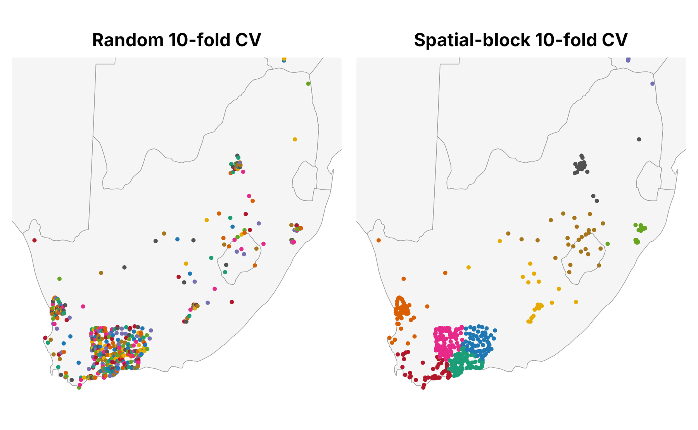
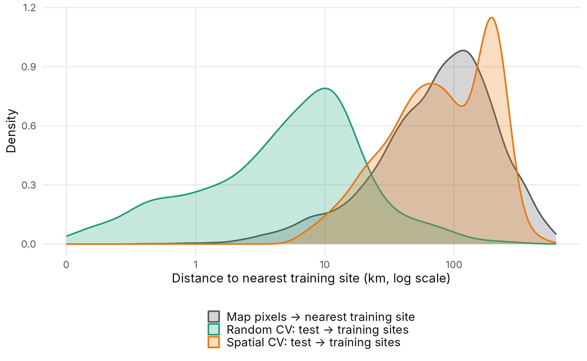
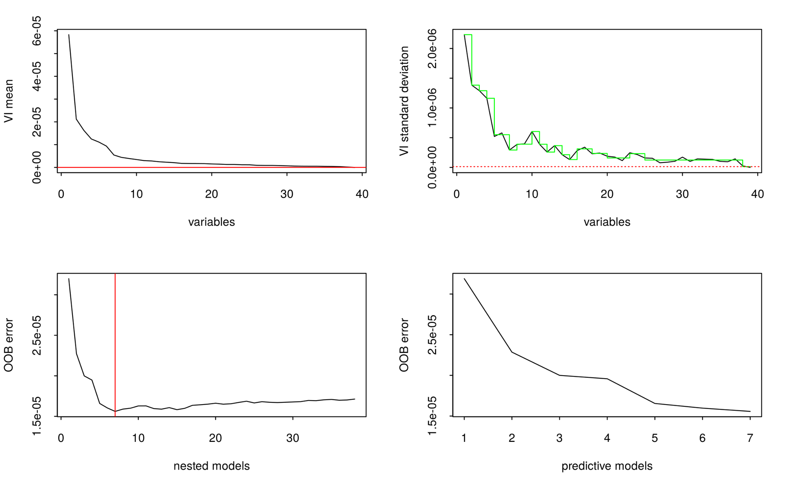
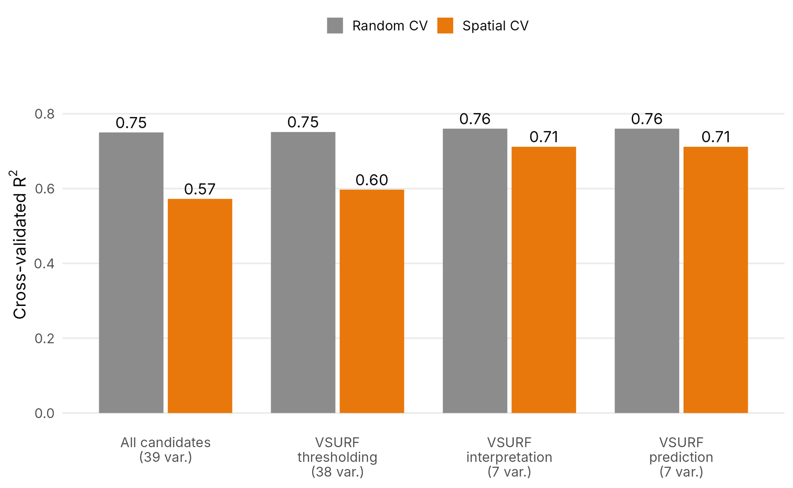
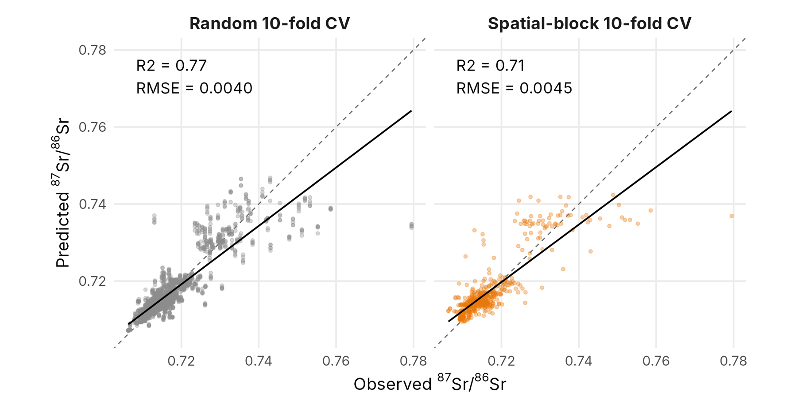
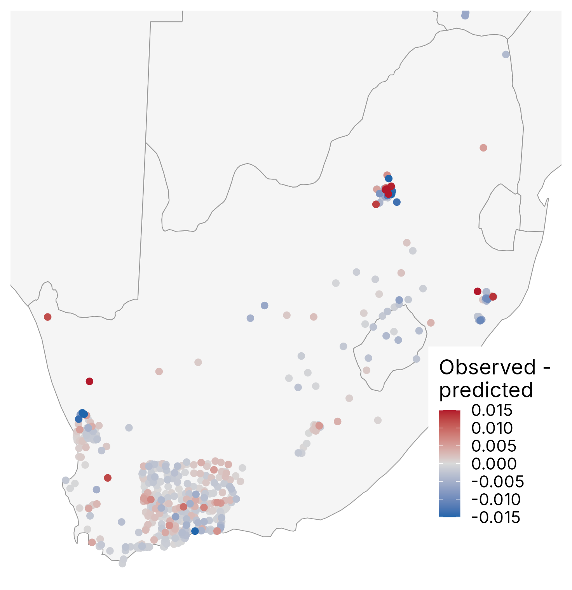

::: {.callout-note appearance="simple" icon="false"}
## In this section

-   **You'll learn:** why random cross-validation is over-optimistic for spatial data, and how to select predictors and tune a random forest with spatial cross-validation
-   **You'll need:** `Output/sr_agg_all.txt` (Section 3)
-   **Time:** about 30 minutes (plus ~8 min of VSURF over lunch)
:::

## Overview

We now train a random forest on all the bioavailable data we prepared. Before selecting predictors and tuning the model, we need to decide **how we will evaluate it**, because the evaluation drives both.

## Step 4.1: Training set

If Sections 1 to 3 took too long, you can start here: the training set is saved in `Output/`.

```{r}
#| label: training-set
sr_agg <- read.table("Output/sr_agg_all.txt", sep = "\t", h = T)

# Training sites as sf points (Eckert IV), used for maps and distances below
sites_sf <- st_as_sf(sr_agg, coords = c("X", "Y"), crs = eck4, remove = FALSE)

# Small helper used throughout Step 4: cross-validated predictions of a ranger
# model for a set of predictors and a vector of fold numbers (one per site).
# It returns RMSE and R2 of the out-of-fold predictions.
cv_ranger <- function(vars, folds, data = sr_agg, num.trees = 300) {
  pred <- rep(NA_real_, nrow(data))
  for (k in unique(folds)) {
    test <- folds == k
    m <- ranger(x = data[!test, vars, drop = FALSE], y = data$X87Sr86Sr[!test],
                num.trees = num.trees, seed = 1)
    pred[test] <- predict(m, data[test, vars, drop = FALSE])$predictions
  }
  c(RMSE = sqrt(mean((data$X87Sr86Sr - pred)^2)), R2 = cor(data$X87Sr86Sr, pred)^2)
}
```

## Step 4.2: Random vs. spatial cross-validation

In a regular (**random**) k-fold cross-validation, the sites are split at random into 10 folds, and each fold is predicted by a model trained on the other 9. But ⁸⁷Sr/⁸⁶Sr data are spatially clustered: in South Africa, most sites are in the south-western Cape. A test site almost always has a training site a few hundred metres away, with the same geology and the same ⁸⁷Sr/⁸⁶Sr. Random cross-validation therefore measures how well the model **interpolates between nearby sites**, not how well it predicts **the large unsampled regions** of the map.

In a **spatial-block** cross-validation, the folds are geographical clusters of sites (here 10 clusters made with k-means on the X/Y coordinates). The model is always tested on a region it has not seen.

```{r}
#| label: folds
# Random folds (10-fold)
set.seed(1)
random_folds <- sample(rep(1:10, length.out = nrow(sr_agg)))

# Spatial folds: 10 geographical clusters of sites (k-means on the coordinates)
# (more advanced alternatives: blockCV package, or CAST::knndm, Linnenbrink et al., 2024)
set.seed(1)
spatial_folds <- kmeans(sr_agg[, c("X", "Y")], centers = 10, nstart = 20)$cluster

# Map of the two fold designs
par(mfrow = c(1, 2), mar = c(0, 0, 2, 0))
plot(st_geometry(za_p), main = "Random 10-fold CV", border = "grey50")
points(sr_agg$X, sr_agg$Y, col = rainbow(10)[random_folds], pch = 16, cex = 0.6)
plot(st_geometry(za_p), main = "Spatial-block 10-fold CV", border = "grey50")
points(sr_agg$X, sr_agg$Y, col = rainbow(10)[spatial_folds], pch = 16, cex = 0.6)
```

{width="80%"}

A good cross-validation should mimic the prediction situation (Meyer & Pebesma, 2022). We compare the distance from each test site to its nearest training site with the distance from each pixel of the map to its nearest training site.

```{r}
#| label: distances
#| code-fold: true
#| code-summary: "Show the code"
# Distance (km) from each point of 'from' to its nearest point in 'to'
nn_dist <- function(from, to) {
  idx <- st_nearest_feature(from, to)
  as.numeric(st_distance(from, to[idx, ], by_element = TRUE)) / 1000
}

# 1. Prediction situation: 5000 random pixels of the map -> nearest training site
map_pts <- st_as_sf(spatSample(r.srsrq1, size = 5000, method = "random", na.rm = TRUE, as.points = TRUE))
map_pts <- suppressWarnings(st_set_crs(map_pts, st_crs(sites_sf)))   # same Eckert IV projection, harmonise the CRS label
d_map <- nn_dist(map_pts, sites_sf)

# 2. Cross-validation situation: each test site -> nearest training site of the other folds
cv_dist <- function(folds) {
  unlist(lapply(unique(folds), function(k) nn_dist(sites_sf[folds == k, ], sites_sf[folds != k, ])))
}
d_random  <- cv_dist(random_folds)
d_spatial <- cv_dist(spatial_folds)

dist_df <- rbind(data.frame(type = "Map pixels -> training sites (prediction)", dist = d_map),
                 data.frame(type = "Random CV: test -> training sites", dist = d_random),
                 data.frame(type = "Spatial CV: test -> training sites", dist = d_spatial))

p_dist <- ggplot(dist_df, aes(x = dist + 0.1, colour = type, fill = type)) +
  geom_density(alpha = 0.2) +
  scale_x_log10(breaks = c(0.1, 1, 10, 100, 1000), labels = c("0", "1", "10", "100", "1000")) +
  labs(x = "Distance to nearest training site (km, log scale)", y = "Density", colour = NULL, fill = NULL) +
  theme_minimal() + theme(legend.position = "bottom", legend.direction = "vertical")
p_dist
ggsave("Output/FigS5_distances_CV.pdf", p_dist, width = 8, height = 6)

# Median distances (km)
round(c(map = median(d_map), random_CV = median(d_random), spatial_CV = median(d_spatial)), 1)
```

{width="80%"}

::: {.callout-warning icon="false"}
## 🔍 Look carefully

In random cross-validation, the test sites are typically less than 1 km from a training site (median 6 km), whereas the median map pixel is 84 km from any data. The spatial cross-validation (84 km) is much closer to the real prediction situation. **This is why we use the spatial cross-validation for predictor selection (Step 4.4) and tuning (Step 4.6).**
:::

## Step 4.3: Predictor selection with VSURF

VSURF (Variable Selection Using Random Forests) ranks the predictors by their importance in a series of random forests, then removes the less important ones step by step. It returns three nested sets:

| Set | VSURF step | What it keeps |
|------------------|------------------|-------------------------------------|
| `varselect.thres` | thresholding | removes the variables indistinguishable from noise; keeps most variables |
| `varselect.interp` | interpretation | all the variables related to ⁸⁷Sr/⁸⁶Sr, including correlated ones |
| `varselect.pred` | prediction | the smallest set that gives the best prediction; very restrictive |

Here we use `varselect.interp` by default: it keeps more variables (and therefore more processes) for nearly the same accuracy. Then, in Step 4.4, we prune it with the spatial cross-validation.

::: callout-warning
## VSURF behaves like a random cross-validation

VSURF uses the out-of-bag error, which does not know about spatial autocorrelation. Interpret its results cautiously.
:::

::: callout-important
## This step takes ~8 minutes

Start it before lunch! If your laptop is slow, load the saved result instead: `load("Output/VSURF_all")`.
:::

```{r}
#| label: vsurf
# Set a random seed for reproducibility
set.seed(1)
# Create a copy of 'sr_agg'
sr_agg0 <- sr_agg

# Apply VSURF algorithm to select relevant variables for predicting 'X87Sr86Sr'
# Using the 'ranger' implementation with parallelization
# Columns 1 to 3 are X87Sr86Sr, X and Y: the covariates start at column 4
sr_agg1.vsurf <- VSURF(
  sr_agg0[, 4:ncol(sr_agg0)],
  sr_agg0$X87Sr86Sr,
  mtry = max(floor((ncol(sr_agg0) - 3)/3), 1),
 ntree.thres = 1000,
 nfor.thres = 20,
 nmin = 1,
 ntree.interp = 1000,
 nfor.interp = 10,
 nsd = 1,
 ntree.pred = 1000,
 nfor.pred = 10,
 nmj = 1,
  RFimplem = "ranger",
  parallel = TRUE,
  ncores = n_cores,
  clusterType = "PSOCK"
)

save(sr_agg1.vsurf, file = "Output/VSURF_all")
```

```{r}
#| label: vsurf-results
#Plot VSURF results
plot(sr_agg1.vsurf)

# Names of the covariates (columns 4 to end)
covariate_names <- names(sr_agg0)[4:ncol(sr_agg0)]

# Variables selected at each of the three VSURF steps
vsurf_sets <- list(thres  = covariate_names[sr_agg1.vsurf$varselect.thres],
                   interp = covariate_names[sr_agg1.vsurf$varselect.interp],
                   pred   = covariate_names[sr_agg1.vsurf$varselect.pred])
lengths(vsurf_sets)
vsurf_sets

# Choose the VSURF step used for the next steps: "interp" (default) or "pred" (as in the global script)
vsurf_step <- "interp"
vars_vsurf <- vsurf_sets[[vsurf_step]]
```

{width="80%"}

## Step 4.4: Spatial pruning of the predictors

Some predictors help to "recognise" the places where the training sites are (they act as a proxy for coordinates) but do not help to predict unsampled regions. To find them, we do a **backward elimination with the spatial cross-validation**:

1.  Compute the spatial-CV RMSE with all the VSURF variables.
2.  Remove each variable in turn and recompute the spatial-CV RMSE.
3.  If removing one variable improves the RMSE by more than `tol` (2%), remove the one that improves it most and go back to 2. Otherwise stop.

Why 2%? The spatial-CV RMSE changes by ~0.5–1% just by changing the random seed, so smaller "improvements" are noise. (For a more systematic approach, see the forward feature selection with spatial CV of Meyer et al. 2018, in the CAST package.)

```{r}
#| label: pruning
spatial_pruning <- TRUE
tol <- 0.02
ntree_pruning <- 1000

vars_final <- vars_vsurf
best <- cv_ranger(vars_final, spatial_folds, num.trees = ntree_pruning)["RMSE"]
pruning_path <- data.frame(step = 0, n_vars = length(vars_final), RMSE = best, removed = "start (VSURF set)")

if (spatial_pruning) {
  repeat {
    if (length(vars_final) <= 2) break
    # spatial-CV RMSE after removing each variable in turn
    rmse_without <- sapply(vars_final, function(v) cv_ranger(setdiff(vars_final, v), spatial_folds, num.trees = ntree_pruning)["RMSE"])
    if (min(rmse_without) < best * (1 - tol)) {
      worst <- vars_final[which.min(rmse_without)]
      vars_final <- setdiff(vars_final, worst)
      best <- min(rmse_without)
      pruning_path <- rbind(pruning_path, data.frame(step = nrow(pruning_path), n_vars = length(vars_final),
                                                     RMSE = best, removed = worst))
    } else break
  }
}
pruning_path
vars_final

# Training dataset for random forest: 87Sr/86Sr + selected predictors
training_rf <- sr_agg[, c("X87Sr86Sr", vars_final)]
```

## Step 4.5: Compare the predictor sets

For each set of predictors, we compare the R² obtained with random and with spatial cross-validation.

```{r}
#| label: compare-sets
#| code-fold: true
#| code-summary: "Show the code"
sets <- list("All candidates" = names(sr_agg)[4:ncol(sr_agg)],
             "VSURF thres" = vsurf_sets$thres,
             "VSURF interp" = vsurf_sets$interp,
             "VSURF pred" = vsurf_sets$pred,
             "Final (spatially pruned)" = vars_final)

set_compare <- do.call(rbind, lapply(names(sets), function(s) {
  data.frame(set = s, n_vars = length(sets[[s]]),
             CV = c("Random CV", "Spatial CV"),
             R2 = c(cv_ranger(sets[[s]], random_folds)["R2"], cv_ranger(sets[[s]], spatial_folds)["R2"]))
}))
set_compare$set <- factor(paste0(set_compare$set, "\n(", set_compare$n_vars, " var.)"),
                          levels = unique(paste0(set_compare$set, "\n(", set_compare$n_vars, " var.)")))
set_compare

p_sets <- ggplot(set_compare, aes(x = set, y = R2, fill = CV)) +
  geom_col(position = "dodge") +
  geom_text(aes(label = round(R2, 2)), position = position_dodge(0.9), vjust = -0.3, size = 3) +
  scale_fill_manual(values = c("Random CV" = "grey60", "Spatial CV" = "darkorange")) +
  labs(x = NULL, y = "Cross-validated R2", fill = NULL, title = "Random CV hides what spatial CV reveals") +
  theme_minimal()
p_sets
ggsave("Output/FigS6_predictor_sets_CV.pdf", p_sets, width = 10, height = 5)

# Path of the spatial pruning
if (nrow(pruning_path) > 1) {
  ggplot(pruning_path, aes(x = step, y = RMSE)) +
    geom_line() + geom_point() +
    geom_text(aes(label = removed), vjust = -0.8, size = 3) +
    labs(x = "Pruning step", y = "Spatial-CV RMSE", title = "Spatial pruning of the VSURF variables") +
    theme_minimal()
}
```

{width="85%"}

## Step 4.6: Tune and train the random forest

-   We use the fast **ranger** implementation, which uses all the cores of your computer by itself.
-   We tune `mtry` (number of variables sampled at each split) and `min.node.size` (minimum number of sites in a terminal node).
-   The tuning uses the **spatial folds**: we choose the hyperparameters that predict new regions best.
-   The model is trained with `quantreg = TRUE` (quantile regression forest, Meinshausen 2006). The **same model** gives the mean isoscape and its uncertainty in [Section 6](06-isoscape.qmd).

```{r}
#| label: train
# Spatial-block cross-validation: one spatial cluster is left out at a time
# index    = for each fold, the rows used for training (all the other blocks)
# indexOut = for each fold, the rows used for testing (the block left out)
blocks <- sort(unique(spatial_folds))
fitControl_spatial <- trainControl(
   method = "cv",
   index    = lapply(blocks, function(k) which(spatial_folds != k)),
   indexOut = lapply(blocks, function(k) which(spatial_folds == k)),
   savePredictions = "final",
   verboseIter = FALSE,
   allowParallel = FALSE)   # ranger is already multi-threaded

# Tuning grid: mtry and min.node.size (splitrule fixed to "variance" for regression)
n_pred <- length(vars_final)
tunegrid <- expand.grid(mtry = unique(pmax(1, round(n_pred * c(0.2, 0.33, 0.5, 0.75)))),
                        splitrule = "variance",
                        min.node.size = c(5, 10, 20))

set.seed(1)
RF_all <- train(X87Sr86Sr ~ ., data = training_rf,
                method = "ranger", metric = "RMSE",
                tuneGrid = tunegrid, trControl = fitControl_spatial,
                num.trees = 500, quantreg = TRUE, importance = "permutation", seed = 1)

save(RF_all, file = "Output/RF_all")

# Note: in this table, Rsquared is the mean of the R2 computed within each spatial
# block. It is low because each block covers a small range of 87Sr/86Sr. The
# tuning uses RMSE; the pooled R2 of all out-of-block predictions is computed below.
# The spatial blocks have different sizes (one contains most of the Cape sites).
RF_all
RF_all$bestTune
```

For comparison, the classic random repeated 10-fold cross-validation with the same hyperparameters:

```{r}
#| label: train-random
# Classic random repeated 10-fold cross-validation with the same hyperparameters (for comparison)
fitControl_random <- trainControl(
   method = "repeatedcv",  # 10-fold Crossvalidation
   number = 10,
   repeats = 5,            # Repeated five times
   savePredictions = "final",
   allowParallel = FALSE)

set.seed(1)
RF_random <- train(X87Sr86Sr ~ ., data = training_rf,
                   method = "ranger", metric = "RMSE",
                   tuneGrid = RF_all$bestTune, trControl = fitControl_random,
                   num.trees = 500, seed = 1)

cv_compare <- rbind(
  Random_CV  = postResample(RF_random$pred$pred, RF_random$pred$obs),
  Spatial_CV = postResample(RF_all$pred$pred, RF_all$pred$obs))
cv_compare
write.csv(cv_compare, "Output/cross_validation_random_vs_spatial.csv")
```

## Step 4.7: Plot the cross-validation results

```{r}
#| label: cv-plots
#| code-fold: true
#| code-summary: "Show the plotting code"
cv_pred <- rbind(data.frame(RF_random$pred[, c("obs", "pred")], CV = "Random 10-fold CV (repeated 5 times)"),
                 data.frame(RF_all$pred[, c("obs", "pred")],    CV = "Spatial-block 10-fold CV"))

# Axis limits adapted to the South African 87Sr/86Sr range
sr_lim <- range(c(cv_pred$obs, cv_pred$pred))

p1 <- ggplot(cv_pred, aes(x = obs, y = pred)) +
    geom_bin_2d(binwidth = 0.001) +
    geom_abline(slope = 1, intercept = 0, linetype = 3) +
    geom_smooth(method = "lm", colour = "black") +
    scale_fill_viridis_c(option = "magma", direction = -1, trans = "sqrt") +
    coord_cartesian(xlim = sr_lim, ylim = sr_lim) +
    facet_wrap(~ CV) +
    labs(fill = "Count") +
    xlab("87Sr/86Srobs") +
    ylab("87Sr/86Srmod")

p2 <- ggplot(cv_pred, aes(x = obs, y = pred - obs)) +
    geom_bin_2d(binwidth = 0.001, show.legend = FALSE) +
    scale_fill_viridis_c(option = "magma", direction = -1, trans = "sqrt") +
    facet_wrap(~ CV) +
    xlab("87Sr/86Srobs") +
    ylab("Residuals")

p3 <- p1 / p2 + plot_annotation(
    title = "Model performance: random vs. spatial cross-validation"
  )
p3
ggsave("Output/FigS2.pdf", p3, width = 14, height = 12)
```



Where are the large errors of the spatial cross-validation?

```{r}
#| label: residual-map
#| code-fold: true
#| code-summary: "Show the code"
# Map of the spatial-CV residuals (observed - predicted) at each site
res_sp <- RF_all$pred[order(RF_all$pred$rowIndex), ]
sites_sf$resid_spatial <- res_sp$obs - res_sp$pred

p_res <- ggplot() +
  geom_sf(data = za_p, fill = "grey95", colour = "grey60") +
  geom_sf(data = sites_sf[order(abs(sites_sf$resid_spatial)), ], aes(colour = resid_spatial), size = 1.5) +
  scale_colour_gradient2(low = "blue", mid = "grey90", high = "red", midpoint = 0,
                         limits = c(-0.015, 0.015), oob = scales::squish, name = "obs - pred") +
  coord_sf(xlim = range(sr_agg$X) + c(-1e5, 1e5), ylim = range(sr_agg$Y) + c(-1e5, 1e5)) +
  ggtitle("Spatial-CV residuals") +
  theme_minimal()
p_res
ggsave("Output/FigS7_residual_map.pdf", p_res, width = 8, height = 7)
```

{width="60%"}

::::::: think-pair-share
### Think · Pair · Share: random vs. spatial CV

Same model, same data: random CV R² = 0.77 (RMSE 0.0040), spatial-block CV R² = 0.71 (RMSE 0.0045). **Which one would you report in a paper, and why?**

:::::: tps-steps
::: tps-step
**💭 Think** [1 min]{.tps-time}

```{r}
#| label: tps-cv
cv_compare
```

On your own, compare the fold maps and the distance plot: test sites sit 6 km (random) vs. 84 km (spatial) from the training data, and map pixels sit 84 km away.
:::

::: tps-step
**🤝 Pair** [3 min]{.tps-time}

With your neighbour:

-   Random CV barely changes between predictor sets; spatial CV separates them. What does that tell you about OOB error and VSURF?
-   What are the weaknesses of spatial CV?
:::

::: tps-step
**📣 Share** [5 min]{.tps-time}

Tell the room:

-   When would random CV be acceptable?
-   How would you design spatial folds for your own study area and sampling design?
:::
::::::
:::::::

::: {.callout-caution collapse="true"}
## Things you might have noticed

**🎲 Problems with random CV**

-   Test sites sit next to training sites: it measures interpolation, not prediction in unsampled regions.
-   It is over-optimistic, and it rewards covariates that act as coordinates (the coarse aerosol layers).
-   It cannot tell a good predictor set from a bad one, and the OOB error and VSURF share this blind spot.

**🧩 Problems with spatial CV**

-   Results depend on the number and size of the blocks ([Exercise 3](#exercises)). k-means blocks are unequal: one holds most of the Cape sites.
-   It can be pessimistic if the blocks force more extrapolation than the map needs.
-   Within-block R² is low because each block spans a narrow Sr range: pool the predictions (as in Step 4.7).

**✅ When random CV is OK**

-   Dense, even sampling, where map pixels are as close to the data as the test sites are.
-   The goal is interpolation inside the sampled area.

**📐 Designing your folds**

-   Match the CV distance distribution to the prediction distances (Meyer & Pebesma 2022; `CAST::knndm()`, the `blockCV` package).
-   Use the same CV for predictor selection, tuning and reporting, and show the residual map.
-   Both CVs under-predict the radiogenic sites (\> 0.73).

**Take-home:** report the spatial CV. It is the honest estimate for the places your animals actually came from.
:::

## Exercises

### Exercise 1: VSURF step

::: {.callout-tip icon="false"}
## 🧩 Your turn

Use `vsurf_step <- "pred"` (as in the global script) instead of `"interp"` in Step 4.3, then re-run Steps 4.4 to 4.7.

1.  How many variables are kept?
2.  Does the spatial CV change?
:::

### Exercise 2: pruning tolerance

::: {.callout-tip icon="false"}
## 🧩 Your turn

Change `tol` in Step 4.4 to 0.005 and to 0.05.

1.  How many variables are kept?
2.  How does the spatial CV change?
:::

::: {.callout-caution collapse="true"}
## Hint

Look at `pruning_path` after each run: it lists which variable was removed at each step and the spatial-CV RMSE.
:::

### Exercise 3: spatial folds

::: {.callout-tip icon="false"}
## 🧩 Your turn

Change the number of spatial clusters (`centers = 10` in Step 4.2) to 5 or 20.

1.  How do the distance distributions change?
2.  How does the spatial R² change?
:::

::: {.callout-caution collapse="true"}
## Things to look for

Fewer, larger blocks push the test sites further from the training data, so the spatial R² usually drops. More, smaller blocks bring the CV distances closer to the random CV. The best design is the one whose distances look most like the map's.
:::

## Summary

::: {.callout-note appearance="simple"}
## Key takeaways

-   Random CV measures interpolation between nearby sites; spatial CV measures prediction in new regions.
-   OOB error and VSURF behave like random CV, so we prune and tune with spatial CV.
-   The final model keeps seven predictors, with R² = 0.71 in spatial CV.
:::

# **Next:** [5. Interpreting the model →](05-interpretation.qmd)
