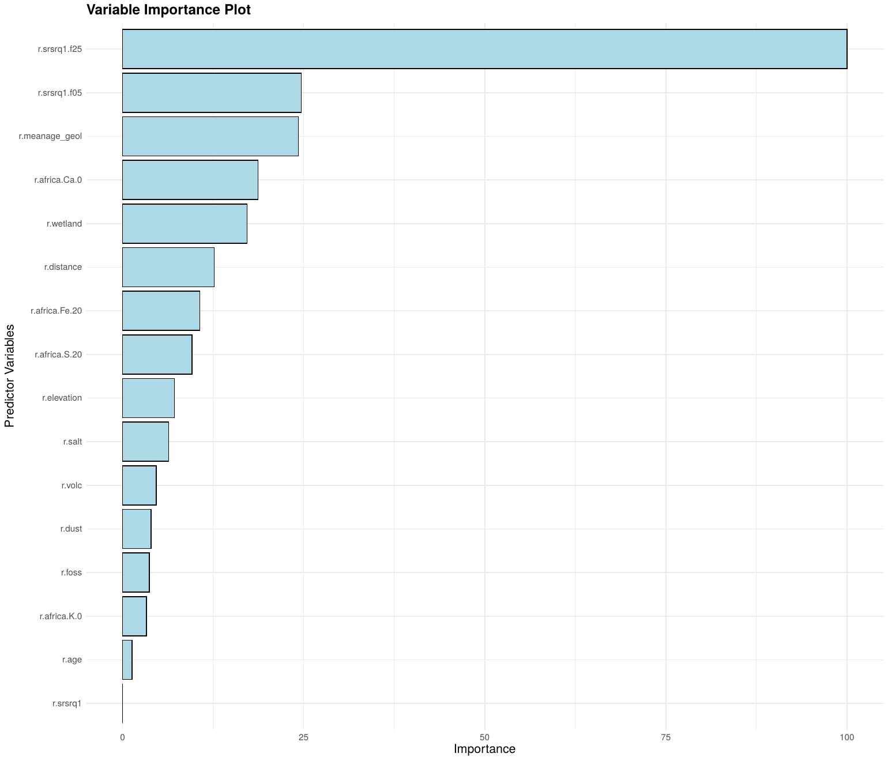
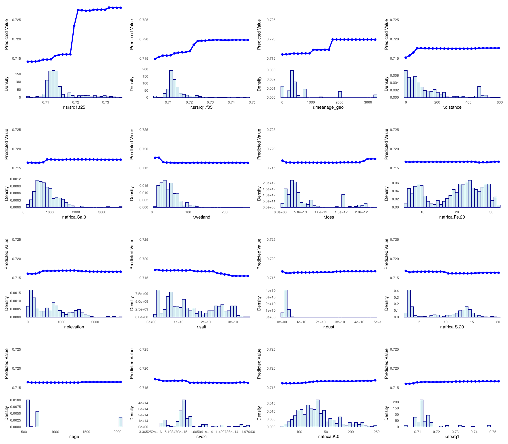

::: {.callout-note appearance="simple" icon="false"}
## In this section

-   **You'll learn:** how to read variable importance and partial dependence plots, and check them against what we know of strontium isotopes
-   **You'll need:** `RF_all` and `training_rf` (Section 4)
-   **Time:** about 15 minutes
:::

## Overview

A random forest averages hundreds of trees, which makes it accurate but hard to interpret. Two tools help us look inside:

-   **Variable importance:** how much the predictions get worse when the values of one covariate are shuffled (permutation importance).
-   **Partial dependence plots (PDPs):** how the predicted ⁸⁷Sr/⁸⁶Sr changes as one covariate varies, averaged over all the others.

User knowledge of Sr cycling is crucial here: the model only finds patterns, it is up to us to decide whether they make sense.

## Step 4.8a: Variable importance

```{r}
#| label: importance
#| code-fold: true
#| code-summary: "Show the code"
# Compute the variable importance using caret
var_imp <- varImp(RF_all, scale = TRUE)

# Convert the results into a data frame
imp_df <- as.data.frame(var_imp$importance)

# Create the importance plot
imp <- ggplot(imp_df, aes(x = reorder(rownames(imp_df), Overall), y = Overall)) +
  geom_bar(stat = "identity", fill = "lightblue", color = "black") +
  coord_flip() +  # Flip the axes for better readability
  labs(x = "Predictor Variables", y = "Importance", title = "Variable Importance Plot") +
  theme_minimal() +
  theme(axis.text = element_text(size = 12),
        axis.title = element_text(size = 14),
        plot.title = element_text(size = 16, face = "bold"),
        axis.text.x = element_text(size = 10),
        axis.text.y = element_text(size = 10))
imp
ggsave("Output/FigS3.pdf", imp, width = 14, height = 12)
```

{width="75%"}

`r.srsrq1.f25`, the mean bedrock ⁸⁷Sr/⁸⁶Sr within 25 km, is by far the most important predictor, followed by `r.srsrq1.f05`, `r.meanage_geol`, `r.africa.Ca.0`, `r.wetland` and `r.distance`. Notice that the pixel-scale bedrock model `r.srsrq1` comes last: its neighbourhood versions carry the same information.

::: callout-warning
## Importance is not a process

Importance tells us which covariates the model uses, not why. Correlated covariates share their importance ([Section 3](03-regression-matrix.qmd)), and a covariate can be important because it acts as a proxy for location.
:::

## Step 4.8b: Partial dependence plots

Each panel shows the predicted ⁸⁷Sr/⁸⁶Sr as one covariate varies while the others are averaged out. The histogram below each curve shows where the training sites are.

```{r}
#| label: pdp
#| code-fold: true
#| code-summary: "Show the code"
# List of predictors to plot
predictors <- vars_final

# Generate partial dependence data for all predictors
# (grid.resolution = 25 points per variable: fast and smooth enough)
partial_data_list <- lapply(predictors, function(predictor) {
  pdp::partial(RF_all$finalModel, pred.var = predictor, train = training_rf[, predictors], grid.resolution = 25)
})

# Name each list element by the predictor variable
names(partial_data_list) <- predictors

# Common y-axis range for all the PDPs (adapted automatically to the data)
pdp_range <- range(unlist(lapply(partial_data_list, function(d) d$yhat)))

# Create ggplot for each partial dependence plot (PDP) and histogram
plots <- lapply(names(partial_data_list), function(predictor) {
  partial_data <- partial_data_list[[predictor]]

  # Extract data for the predictor variable (for histogram)
x_data <- training_rf[[predictor]]

  # Create the PDP plot (Partial Dependence Plot)
pdp_plot <- ggplot() +
    geom_line(data = partial_data, aes(x = .data[[predictor]], y = .data[["yhat"]]), color = "blue", linewidth = 1.2) +
    geom_point(data = partial_data, aes(x = .data[[predictor]], y = .data[["yhat"]]), color = "blue", size = 2) +
    coord_cartesian(xlim = range(x_data), ylim = pdp_range) +  # Same y-axis range for all predictors
    labs(x = NULL, y = "Predicted Value") +             # Remove x-axis title
    theme_minimal() +
    theme(
      axis.text = element_text(size = 8),               # Smaller axis numbers
      axis.title = element_text(size = 10),             # Smaller axis titles
      plot.title = element_blank(),
      panel.grid = element_blank(),
      axis.text.x = element_blank(),                    # Remove x-axis numbers
      axis.title.x = element_blank(),                   # Remove x-axis title
      axis.ticks.x = element_blank()
    )

  # Create the Histogram for the predictor distribution
hist_plot <- ggplot() +
    geom_histogram(data = data.frame(x = x_data), aes(x = x, y = after_stat(density)),
                   bins = 30, fill = "lightblue", color = "darkblue", alpha = 0.5) +
    coord_cartesian(xlim = range(x_data)) +  # Align x-axis with the PDP
    labs(x = predictor, y = "Density") +
    theme_minimal() +
    theme(
      axis.text = element_text(size = 8),           # Smaller axis numbers
      axis.title = element_text(size = 10),         # Smaller axis titles
      plot.title = element_blank(),
      panel.grid = element_blank(),
      axis.text.x = element_text(size = 8),         # Smaller x-axis numbers
      axis.ticks.x = element_blank()
    )

  # Return the combined plot as a list (PDP + histogram)
  list(pdp_plot = pdp_plot, hist_plot = hist_plot)
})

# Combine both plots (PDP and histogram) into a single plot with aligned x-axes
combined_plots <- lapply(plots, function(p) {
  p$pdp_plot + p$hist_plot + plot_layout(ncol = 1, heights = c(2, 1))
})

# Combine all plots into a single layout (adjust ncol to 3 or any number for better arrangement)
final_plot <- wrap_plots(combined_plots, ncol = 4)
final_plot
# Save the final plot as a PDF
ggsave("Output/FigS4.pdf", final_plot, width = 16, height = 14)
```



::::::: think-pair-share
### Think · Pair · Share: reading partial dependence

Each curve is the predicted ⁸⁷Sr/⁸⁶Sr as one covariate varies, averaged over all the others. **Does each relationship make sense with what we know of strontium isotopes?**

:::::: tps-steps
::: tps-step
**💭 Think** [2 min]{.tps-time}

On your own, describe the curves (start with the six most important predictors):

-   Rising, falling, flat, or a step?
-   Where along the x-axis are the data?
:::

::: tps-step
**🤝 Pair** [3 min]{.tps-time}

With your neighbour:

-   Match each curve to a Sr process: rock age and Rb/Sr, sea-salt input, carbonate and exchangeable Ca, mixing.
-   Which curves surprise you? Does `r.africa.Ca.0` go the way you expected? And `r.wetland`?
:::

::: tps-step
**📣 Share** [3 min]{.tps-time}

Tell the room:

-   Which curve would you trust least, and why?
-   Can a strange curve point to a problem with the data, a covariate or the model?
:::
::::::
:::::::

::: {.callout-caution collapse="true"}
## Things you might have noticed

**✔️ Consistent with Sr cycling**

-   **Neighbourhood bedrock Sr** (`f25`, `f05`): bioavailable Sr rises with the bedrock model, but the slope is well below 1:1. Atmospheric Sr and the preferential weathering of low-⁸⁷Sr/⁸⁶Sr minerals pull the values together.
-   **Geological age:** older units are more radiogenic (⁸⁷Rb decay), in steps.
-   **Distance to coast:** lowest within ~75 km of the sea, then a plateau. Sea-salt Sr (0.7092) dilutes the rock signal.

**❓ Worth discussing**

-   The sharp step in `f25` at ~0.718–0.720: a real threshold, or a few radiogenic sites (sparse rug) driving one split?
-   Extractable Ca: a weak *positive* effect. Did you expect high Ca → carbonate → lower ⁸⁷Sr/⁸⁶Sr? Could Ca instead track arid, calcrete-rich soils over old basement?
-   Wetland: higher Sr where wetland cover is low. A process, or a proxy for location?
-   `r.srsrq1` (bedrock under the pixel) has ~0 importance, while its 5 and 25 km versions dominate. What does that say about where bioavailable Sr comes from?
-   The coarse layers (`r.salt`, `r.dust`, `r.volc`, `r.foss`) have flat curves and low importance. Process, or proxy for location?

**⚠️ Read PDPs carefully**

-   Flat ends beyond the data: random forest cannot extrapolate, so predictions stay constant outside the training range.
-   Correlated covariates (`f05`, `f25`): the curve averages over unrealistic combinations.
-   Amplitude ≠ importance, and interactions are hidden: try ICE curves or 2-D PDPs.

**Take-home:** a PDP tests the model against your knowledge of Sr cycling. It does not prove a process.
:::

## Summary

::: {.callout-note appearance="simple"}
## Key takeaways

-   Neighbourhood bedrock ⁸⁷Sr/⁸⁶Sr dominates the model, followed by geological age, soil Ca, wetland and distance to the coast.
-   Most partial dependence curves agree with Sr cycling; the ones that don't are worth a closer look.
-   Random forests cannot extrapolate beyond the range of the training data.
:::

# **Next:** [6. Isoscape and uncertainty →](06-isoscape.qmd)
