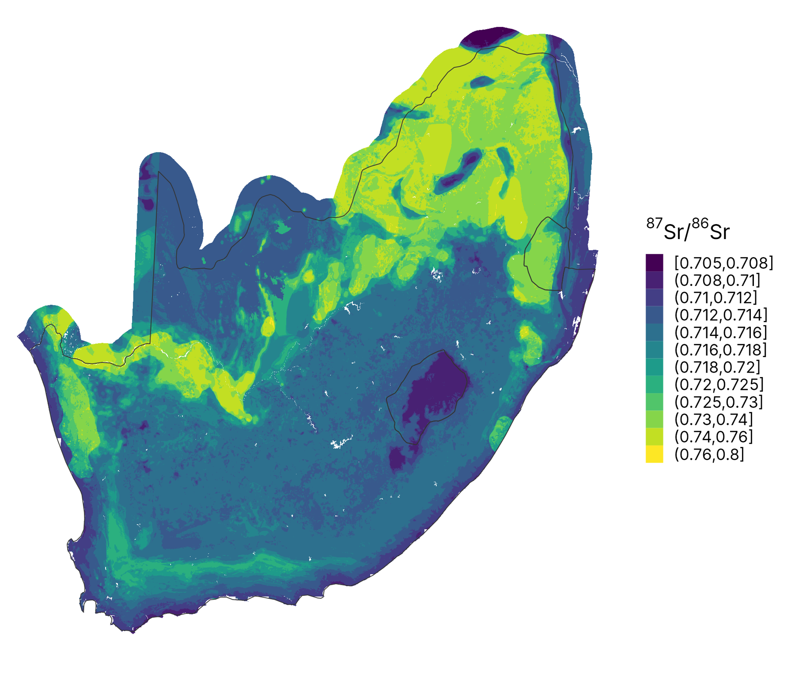
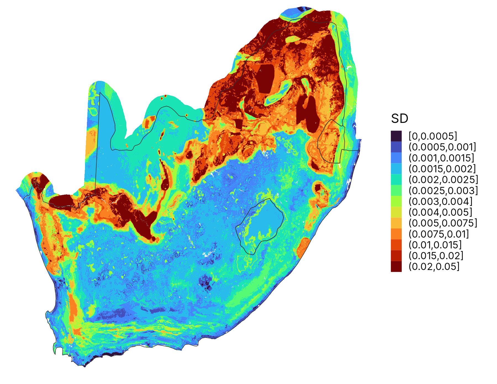
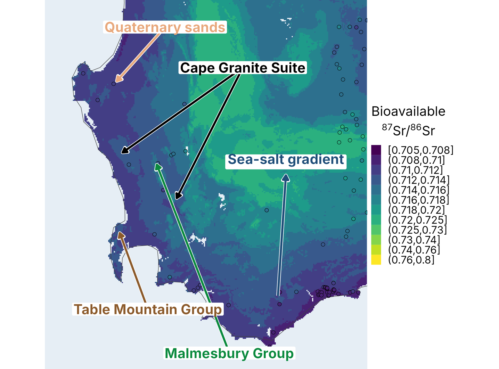
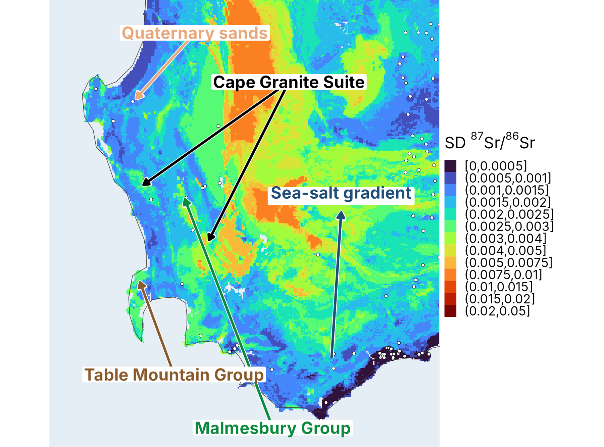

::: {.callout-note appearance="simple" icon="false"}
## In this section

-   **You'll learn:** how to predict the isoscape and its uncertainty, and how to read them before using them for assignment
-   **You'll need:** `RF_all` (Section 4) and `stack_all` (Section 2)
-   **Time:** about 15 minutes (plus ~5 min of prediction)
:::

## Overview

We now apply the trained model to every 1 km pixel of South Africa. Because the model was trained as a **quantile random forest** (`quantreg = TRUE`), the same model gives both the mean isoscape and its uncertainty in a single pass.

## Step 5.1: Create the predictor stack

The stack must contain the same covariates, with the same names, as the training table.

```{r}
#| label: predictor-stack
# Stack of the selected predictors (same names as in the training table)
stack_sel <- stack_all[[predictors]]
stack_sel
```

## Step 5.2: Mean isoscape and uncertainty in a single pass

A random forest gives one prediction per pixel (the mean of all trees). A quantile random forest can also predict quantiles of the distribution in each pixel. The 15.9% and 84.1% quantiles bracket 68% of the predictions (±1 SD if the distribution is normal). Half of this range is our uncertainty (1 SD), which is what we need for Bayesian assignment with assignR in Module 3.

`terra::predict()` reads the rasters block by block (so memory is not a problem), calls our small function on each block, and writes the three layers (mean, Q15.9, Q84.1) directly to a GeoTIFF.

::: callout-important
## This step takes a few minutes

If memory is limited, increase `steps`. If it is too slow, the results are already in `Output/rf_all_pred.tif` and `Output/rf_all_sd.tif`.
:::

```{r}
#| label: predict
# For a block of pixels: mean prediction + 15.9% and 84.1% quantiles
predict_mean_quantiles <- function(model, data, ...) {
  q <- predict(model, data = data, type = "quantiles", quantiles = c(0.159, 0.841))$predictions
  cbind(mean = predict(model, data = data)$predictions, q159 = q[, 1], q841 = q[, 2])
}

rf_pred <- terra::predict(stack_sel, RF_all$finalModel, fun = predict_mean_quantiles, na.rm = TRUE,
                          filename = "Output/rf_all_pred_quantiles1.tif", overwrite = TRUE,
                          wopt = list(steps = 20, names = c("mean", "q159", "q841")))

# Mean isoscape and uncertainty (1 SD = half of the 68% interval)
rf_sr    <- rf_pred[["mean"]]
rf_sr_sd <- (rf_pred[["q841"]] - rf_pred[["q159"]]) / 2

writeRaster(rf_sr,    filename = "Output/rf_all_pred.tif", overwrite = TRUE)
writeRaster(rf_sr_sd, filename = "Output/rf_all_sd.tif",   overwrite = TRUE)
```

```{r}
#| label: plot-isoscape
###Create breakpoints for random forest prediction map (adapted to the South African range)
breakpoints <- c(0.705, 0.708, 0.710, 0.712, 0.714, 0.716, 0.718, 0.720, 0.725, 0.730, 0.740, 0.760, 0.800)
s_proj$Col <- viridis_pal(option = "viridis")(12)[as.numeric(cut(s_proj$X87Sr86Sr, breaks = breakpoints))]

#Plot the mean prediction of the isoscape using viridis colorscale
par(mfrow = c(1,1))
plot(rf_sr, col = viridis_pal(option = "viridis")(12), breaks = breakpoints, axes = FALSE)
plot(st_geometry(za_p), add = TRUE, border = "grey30")
points(st_coordinates(s_proj), pch = 21, col = "black", bg = s_proj$Col, cex = 0.8)
sbar(200000, xy = "bottomright", type = "bar", divs = 2, below = "km", labels = c(0, 100, 200), cex = 0.7)
```

## Step 5.3: Figures

```{r}
#| label: fig1
#| code-fold: true
#| code-summary: "Show the code for Fig. 1"
pdf("Output/Fig1.pdf", width = 8, height = 7)
# Elevation as a background and training sites coloured by sample type
s_proj$type <- ifelse(grepl("plant", s_proj$material_type), "plant",
                ifelse(grepl("soil", s_proj$material_type), "soil", "fauna"))
par(mfrow = c(1, 1), mar = c(1, 1, 1, 1))
breaks <- c(0, 100, 250, 500, 750, 1000, 1250, 1500, 2000, 2500, 3500)
plot(r.elevation, col = terrain.colors(10), breaks = breaks, axes = FALSE)
plot(st_geometry(za_p), add = TRUE, border = "black", lwd = 0.5)
type_col <- c(plant = "forestgreen", soil = "sienna", fauna = "steelblue")
points(st_coordinates(s_proj), pch = 21, bg = type_col[s_proj$type], cex = 0.9, lwd = 0.4)
legend("topleft", inset = c(0.08, 0.02), legend = names(type_col),
       pt.bg = type_col, pch = 21, pt.cex = 1.3, bty = "n", cex = 0.8, title = "Training data")
sbar(200000, xy = "bottomright", type = "bar", divs = 2, below = "km", labels = c(0, 100, 200), cex = 0.7)
dev.off()
```

```{r}
#| label: fig2
#| code-fold: true
#| code-summary: "Show the code for Fig. 2"
rf_sr_sd <- terra::rast("Output/rf_all_sd.tif")

####Figure for 87Sr/86Sr isoscape with all data
###Create breakpoints for the uncertainty map (adapted to the South African range)
breakpoints2 <- c(0, 0.0005, 0.001, 0.0015, 0.002, 0.0025, 0.003, 0.004, 0.005, 0.0075, 0.01, 0.015, 0.02, 0.05)

pdf("Output/Fig2.pdf", width = 12, height = 5)
# Set up the plotting area with adjusted margins
par(mfrow = c(1, 2), mar = c(0, 0.2, 0, 4), oma = c(0, 0, 0, 4))  # Adjust outer margins (oma) and plot margins (mar)

plot(rf_sr, col = viridis_pal(option = "viridis")(12),
  breaks = breakpoints, axes = FALSE)
plot(st_geometry(za_p), add = TRUE, border = "grey30", lwd = 0.5)
points(st_coordinates(s_proj),pch = 21,col = "white",bg = s_proj$Col,lwd = 0.1,cex = 0.5)
sbar(200000, xy = "bottomright", type = "bar", divs = 2, below = "km", labels = c(0, 100, 200), cex = 0.7)

plot(rf_sr_sd, col = viridis_pal(option = "turbo")(13), breaks = breakpoints2, axes = FALSE)
plot(st_geometry(za_p), add = TRUE, border = "grey30", lwd = 0.5)
points(st_coordinates(s_proj),pch = 21,col = "black",bg = "white",lwd = 0.1,cex = 0.3)
sbar(200000, xy = "bottomright", type = "bar", divs = 2, below = "km", labels = c(0, 100, 200), cex = 0.7)
dev.off()
```

```{r}
#| label: fig-notebook
# Same figure in the notebook
par(mfrow = c(1, 2), mar = c(0, 0.2, 1.5, 4))
plot(rf_sr, col = viridis_pal(option = "viridis")(12), breaks = breakpoints, axes = FALSE, main = "Bioavailable 87Sr/86Sr")
plot(st_geometry(za_p), add = TRUE, border = "grey30", lwd = 0.5)
plot(rf_sr_sd, col = viridis_pal(option = "turbo")(13), breaks = breakpoints2, axes = FALSE, main = "Uncertainty (1 SD)")
plot(st_geometry(za_p), add = TRUE, border = "grey30", lwd = 0.5)
```

::: {layout-ncol="2"}



:::

Zoom into the south-western Cape, where most training sites are:

::: {layout-ncol="2"}



:::

::::::: think-pair-share
### 🗺️ Think · Pair · Share: patterns and uncertainty

Mean isoscape and 1 SD from the quantile random forest. **Can you explain the patterns, and would you trust this map to assign a butterfly?**

:::::: tps-steps
::: tps-step
**💭 Think** [2 min]{.tps-time}

```{r}
#| label: tps-maps
plot(c(rf_sr, rf_sr_sd))
```

On your own:

-   Where is the predicted ⁸⁷Sr/⁸⁶Sr highest and lowest?
-   Where is the SD highest and lowest?
:::

::: tps-step
**🤝 Pair** [3 min]{.tps-time}

With your neighbour:

-   Explain the patterns with geology and Sr sources.
-   Is the SD high where there are no data, where the geology is complex, or both?
-   Do you see artefacts: straight edges, blocks, smooth coordinate-like gradients?
:::

::: tps-step
**📣 Share** [3 min]{.tps-time}

Tell the room:

-   Where would you trust this map for assignment in Module 3?
-   Where would you sample next?
:::
::::::
:::::::

::: {.callout-caution collapse="true"}
## Things you might have noticed

**🪨 Spatial patterns**

-   Radiogenic highs (\> 0.74) in the north-east and along the Orange River and Namaqualand: old granites and gneisses of the Kaapvaal Craton and the Namaqua-Natal belt.
-   Lows (\< 0.712) over Lesotho: the Drakensberg (Karoo) flood basalts.
-   Low values along the coast from sea-salt Sr. In the south-western Cape, a mosaic of Cape Granite Suite, Table Mountain Group, Malmesbury Group and Quaternary sands.

**📊 Uncertainty**

-   The highest SD (\> 0.02) is over the same radiogenic terrains: old rocks have very heterogeneous minerals, and there are few sites.
-   The SD is low over the Karoo interior despite sparse data. A quantile random forest reports the spread of *similar training sites*, not the distance to the data.
-   So the SD can underestimate the error where the model extrapolates. Pair it with an area of applicability (Meyer & Pebesma 2021, `CAST::aoa()`).
-   Check sharp boundaries and blocky shapes against the covariates that created them.

**🦋 For assignment**

-   The SD map becomes the isoscape uncertainty in `assignR::pdRaster()`. An SD that is too small gives over-confident assignments.
-   Sample next where the SD is high or the model extrapolates (north-east, Northern Cape, interior).

**Take-home:** an isoscape is a mean and an uncertainty, and the assignment inherits both.
:::

## Exercises

### Exercise 1: sample types

::: {.callout-tip icon="false"}
## 🧩 Your turn

Train the model with plants only. In Step 1.1, add:

```{r}
#| label: ex1-plants
sr_orig <- sr_orig[grepl("plant", sr_orig$material_type), ]
```

Then re-run the script. Where does the isoscape change? Why?
:::

::: {.callout-caution collapse="true"}
## Things to look for

Compare the two maps in the regions where most of the removed fauna and soil sites were. Small mammals integrate Sr over a home range and diet, and soil leachates sample a different pool than plant roots, so the plant-only map should be closer to what a caterpillar eats. It also has fewer sites, so check the spatial CV and the SD too.
:::

### Exercise 2: uncertainty

::: {.callout-tip icon="false"}
## 🧩 Your turn

Plot the training sites on the SD map. Where is the uncertainty highest? Is it where there are no data, where the geology is complex, or both?
:::

### Exercise 3: from isoscape to assignment

::: {.callout-tip icon="false"}
## 🧩 Your turn

Use `Output/rf_all_pred.tif` and `Output/rf_all_sd.tif` as the isoscape and its uncertainty in a Bayesian assignment with `assignR::pdRaster()`. This is exactly where [Module 3](https://meganreich.github.io/Isoecol2026_Srworkshop_P3/) starts!
:::

## Summary

::: {.callout-note appearance="simple"}
## Key takeaways

-   A quantile random forest gives the mean isoscape and its uncertainty from the same model.
-   The patterns follow geology (old radiogenic basement vs. basalts and carbonates) and sea-salt input.
-   The SD reflects the spread of similar training sites, not the distance to data, so check where the model extrapolates.
-   Choose predictors with process knowledge, validate spatially, and map the uncertainty.
:::

# **Next:** [Module 3: geographic assignment →](https://meganreich.github.io/Isoecol2026_Srworkshop_P3/)
