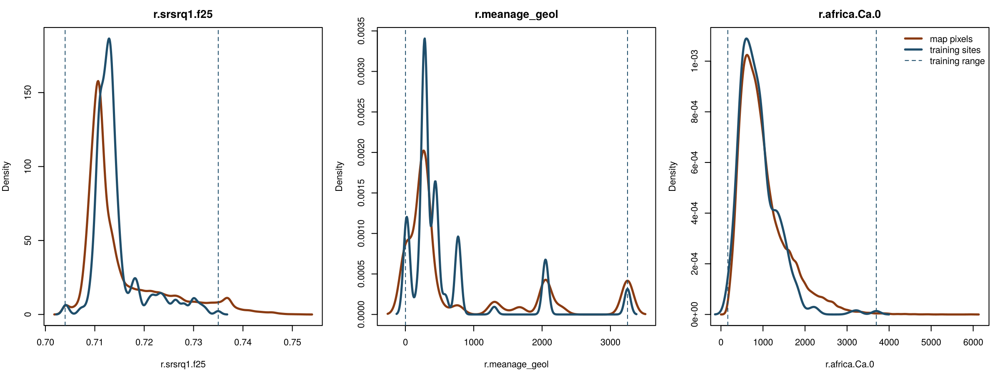
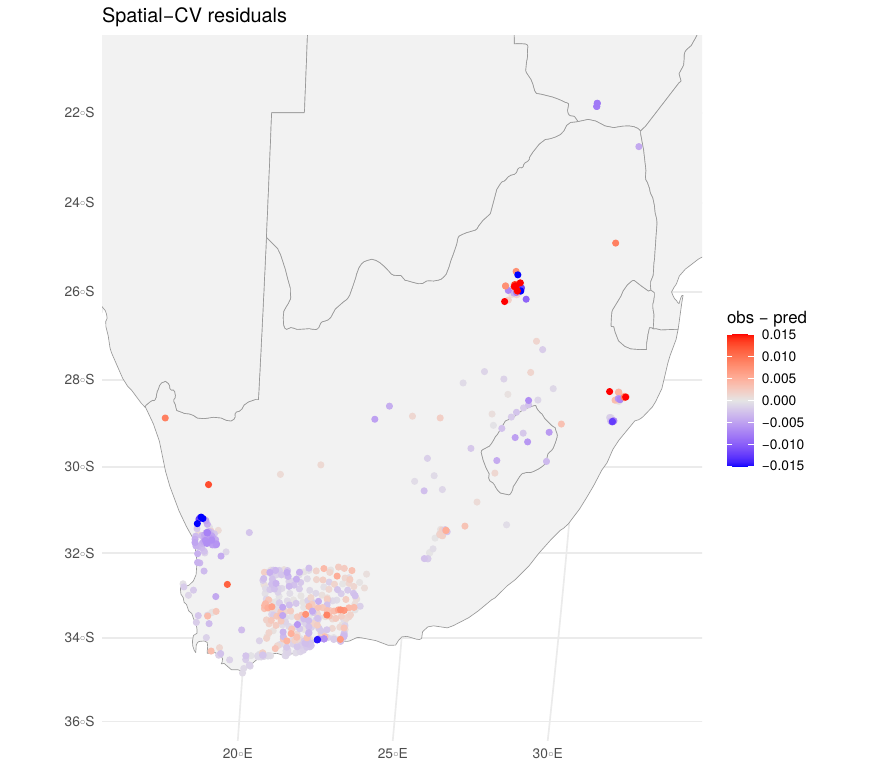

::: {.callout-note appearance="simple" icon="false"}
## In this section

-   **You'll learn:** the main limits of random forest ⁸⁷Sr/⁸⁶Sr isoscapes, how to diagnose them, and what we can do about them
-   **You'll need:** nothing to run: this page is for discussion
-   **Time:** about 15 minutes
:::

## Overview

We built a reasonable isoscape for South Africa: spatial CV R² = 0.66, and patterns that make geological sense. But the model is only as good as the data and covariates it learns from, and some problems remain even with careful cross-validation. Four of them matter most.

| Issue | In one sentence | Way forward |
|-------|-----------------|-------------|
| [1. Data](#issue-1-scarce-and-unharmonised-data) | Few sites, clustered, in many formats | Share data in the ARDUOUS / IsoBank template |
| [2. Extrapolation](#issue-2-extrapolation) | The model can't predict beyond what it has seen | Map where the model applies (area of applicability) |
| [3. Spatial autocorrelation](#issue-3-spatial-autocorrelation) | Errors cluster in space | Spatial CV, plus spatial features in the model |
| [4. Covariates](#issue-4-inaccurate-geology-covariates) | Geological maps are coarse and unharmonised | Better, harmonised geology and geochemistry layers |

## Issue 1: Scarce and unharmonised data

Random forest needs a lot of training data, and bioavailable ⁸⁷Sr/⁸⁶Sr data are still scarce and unevenly spread. In South Africa, most of our 579 sites are in the south-western Cape, and large regions have almost none.

The data also exist in many formats: different sample descriptions, units, coordinates of variable precision, missing information on the material or the pretreatment. Before this module, someone had to merge three compilations (SrBaseline, the Wang compilation and IsoBank), harmonise their fields and screen them by hand. Much of that work is repeated every time a new isoscape is built.

::: {.callout-tip icon="false"}
## 🤝 Way forward: share your data in a common template

-   Report bioavailable ⁸⁷Sr/⁸⁶Sr data in the **ARDUOUS template** ([data descriptor](https://www.nature.com/articles/s41597-026-06643-3), [dataset](https://doi.isoarch.org/10.48530/isoarch.2024.002)), with the metadata needed to screen them: material, sample type, coordinates and their precision, home range of the organism, analytical details.
-   Deposit them in open repositories such as **IsoBank** and **IsoArcH**, as shown in [Module 1](https://github.com/stantis/IsoEcolWorkshop2026).
-   **Every published dataset improves everyone's isoscape**, especially in data-poor regions. More well-described data is the single most effective way to improve the maps.
:::

## Issue 2: Extrapolation

A random forest **cannot extrapolate**: for a covariate value outside the range of its training data, it repeats the prediction it learned at the edge of that range (the flat ends of the [partial dependence plots](05-interpretation.qmd), and of the [toy forest](00-random-forest.qmd#step-0.4-see-it-for-yourself)).

Spatial cross-validation helps, because it tests the model at realistic *distances* from the data. But it can only test on places that have data. It cannot tell us how the model behaves in **environments that no site samples**: a rock type, an age or a climate that is missing from the training set.



In our model:

-   **5.7% of the pixels** have a neighbourhood bedrock ⁸⁷Sr/⁸⁶Sr (`r.srsrq1.f25`) above anything in the training data (\> 0.735). These are the old radiogenic terrains of the north-east, exactly where the isoscape and its SD are highest.
-   **18% of the pixels** fall outside the training range of at least one of the six most important covariates.
-   Even *inside* the range, some environments are barely sampled: look at the geological ages between 1000 and 2000 Myr.

::: {.callout-tip icon="false"}
## 🧭 Way forward: map where the model applies

-   Compute the **area of applicability** (AOA, Meyer & Pebesma 2021): `CAST::aoa()` flags the pixels whose covariates are too different from the training data. Show it next to the isoscape, or mask those pixels.
-   Remember that the quantile random forest SD does not capture this: it can be low in environments the model has never seen ([Section 6](06-isoscape.qmd)).
-   Target new sampling at the environments outside the AOA.
:::

## Issue 3: Spatial autocorrelation

Nearby sites share both their ⁸⁷Sr/⁸⁶Sr and their environment. A random forest treats every site as independent, so:

-   random cross-validation is optimistic ([Section 4](04-cross-validation.qmd));
-   the residuals cluster in space: our model under-predicts around the Bushveld and in KwaZulu-Natal, and over-predicts on parts of the west coast.

{width="60%"}

Clustered residuals mean that some spatial structure is still left in the data that the covariates don't explain, for example a regional basement, a local dust source or a sedimentary system.

::: {.callout-tip icon="false"}
## 🗺️ Way forward: account for space

-   **Spatial cross-validation** for predictor selection, tuning and validation (what we did today).
-   **Spatial features in the model**, so it can learn the leftover spatial structure:
    -   coordinates or *Euclidean distance fields* (distances to a few reference points; Behrens et al. 2018);
    -   *buffer distances* to every training site (RFsp; Hengl et al. 2018);
    -   the values of the *nearest training sites* and their distances (RFSI; Sekulić et al. 2020).
-   **Residual kriging:** interpolate the random forest residuals and add them back to the prediction.

Be careful: spatial features can also let the model "memorise" places. Always check that they improve the **spatial** cross-validation, not just the random one.
:::

A first, simple test you can try: add the coordinates as two extra covariates in Step 2.9 (not run during the workshop).

```{r}
#| label: xy-covariates
# Coordinates as covariates (Eckert IV, metres): one layer with x, one with y
r.x <- init(r.srsrq1, "x"); r.x <- mask(r.x, r.srsrq1)
r.y <- init(r.srsrq1, "y"); r.y <- mask(r.y, r.srsrq1)
# then add "r.x" and "r.y" to predictor_names, re-run the script,
# and compare the random and spatial cross-validation (Fig. S6)
```

## Issue 4: Inaccurate geology covariates

Bioavailable ⁸⁷Sr/⁸⁶Sr is controlled first by the rocks, and the bedrock covariates dominate our model. But they are the weakest link:

-   **Low resolution:** global lithological maps (e.g. GLiM, Hartmann & Moosdorf 2012) generalise geology over large areas, so small but strongly radiogenic or unradiogenic units disappear.
-   **Unharmonised across borders:** national geological maps use different legends, scales and age classes, so units change abruptly at country borders. Regional maps (like the 1:1M map of South Africa) are more detailed, but stop at the border and have hundreds of classes the model cannot learn from.
-   **Age and lithology are approximations:** for sediments, the mapped (depositional) age is not the age of the minerals that release Sr; unconsolidated cover and regolith are poorly mapped.
-   **Our bedrock ⁸⁷Sr/⁸⁶Sr layer is itself a model**, built from those maps, with its own errors.
-   The **atmospheric deposition** layers are even coarser (~1–2°).

::: {.callout-tip icon="false"}
## 🪨 Way forward: better geology covariates

-   **Harmonised, high-resolution geological maps** across borders.
-   **Geochemical and geophysical layers** that measure the rocks directly: airborne radiometric surveys (K, Th, U), stream-sediment and soil geochemistry.
-   Better **bedrock ⁸⁷Sr/⁸⁶Sr models** calibrated on rock data.
-   Getting better geology covariates remains **essential**: no machine-learning method can recover information that the covariates don't contain.
:::

## Tailored strategies

| Situation | Strategy |
|-----------|----------|
| **Data-rich regions** | A globally trained model is robust, but its uncertainty is large. If high-resolution geology or other covariates (e.g. radiometrics) exist, train a regional model. With enough data from one substrate, a substrate-specific isoscape targeted to the question becomes possible. Account for spatial autocorrelation. |
| **Data-poor regions** | A globally trained model (Bataille et al. 2020) gives a first approximation of the values and patterns. Collecting and sharing new bioavailable data remains essential. |

::::::: think-pair-share
### Think · Pair · Share: what would improve your isoscape most?

Data, extrapolation, spatial autocorrelation, covariates: **which one limits isoscapes in your own study area the most, and what could you do about it?**

:::::: tps-steps
::: tps-step
**💭 Think** [2 min]{.tps-time}

On your own, rank the four issues for your own study area, from most to least limiting.
:::

::: tps-step
**🤝 Pair** [3 min]{.tps-time}

With your neighbour, compare your rankings.

-   Why are they different? Think about the size of the area, the geology and the data available.
-   Do you have data that could go into the ARDUOUS template or IsoBank?
:::

::: tps-step
**📣 Share** [3 min]{.tps-time}

Tell the room one concrete step you could take after this workshop to improve the isoscape of your region.
:::
::::::
:::::::

::: {.callout-caution collapse="true"}
## Things you might have noticed

-   **Small, well-sampled regions** are often limited by the covariates: the geological map is not detailed enough to explain the variability between nearby sites.
-   **Large or remote regions** are limited by data and extrapolation: much of the map lies outside the area of applicability.
-   **Clustered sampling** (like ours) makes spatial autocorrelation and optimistic validation the main risk.
-   Almost everyone can contribute to the first issue: publishing well-described bioavailable data in a common template improves every future isoscape.
:::

## References

-   Bataille, C. P., Crowley, B. E., Wooller, M. J., & Bowen, G. J. (2020). Advances in global bioavailable strontium isoscapes. *Palaeogeography, Palaeoclimatology, Palaeoecology*, 555, 109849.
-   Behrens, T., Schmidt, K., Viscarra Rossel, R. A., Gries, P., Scholten, T., & MacMillan, R. A. (2018). Spatial modelling with Euclidean distance fields and machine learning. *European Journal of Soil Science*, 69, 757–770.
-   Hartmann, J., & Moosdorf, N. (2012). The new global lithological map database GLiM. *Geochemistry, Geophysics, Geosystems*, 13, Q12004.
-   Hengl, T., Nussbaum, M., Wright, M. N., Heuvelink, G. B. M., & Gräler, B. (2018). Random forest as a generic framework for predictive modeling of spatial and spatio-temporal variables. *PeerJ*, 6, e5518.
-   Meyer, H., & Pebesma, E. (2021). Predicting into unknown space? Estimating the area of applicability of spatial prediction models. *Methods in Ecology and Evolution*, 12, 1620–1633.
-   Meyer, H., & Pebesma, E. (2022). Machine learning-based global maps of ecological variables and the challenge of assessing them. *Nature Communications*, 13, 2208.
-   Sekulić, A., Kilibarda, M., Heuvelink, G. B. M., Nikolić, M., & Bajat, B. (2020). Random forest spatial interpolation. *Remote Sensing*, 12, 1687.

## Summary

::: {.callout-note appearance="simple"}
## Key takeaways

-   More, better-described data in a common template (ARDUOUS, IsoBank) is the most effective way to improve isoscapes.
-   Random forests can't extrapolate: map the area of applicability, and don't trust the SD alone.
-   Clustered residuals reveal spatial structure the covariates miss: validate spatially and consider spatial features.
-   Better, harmonised geology covariates remain essential.
:::

# **Next:** [Module 3: geographic assignment →](https://meganreich.github.io/Isoecol2026_Srworkshop_P3/)
