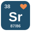
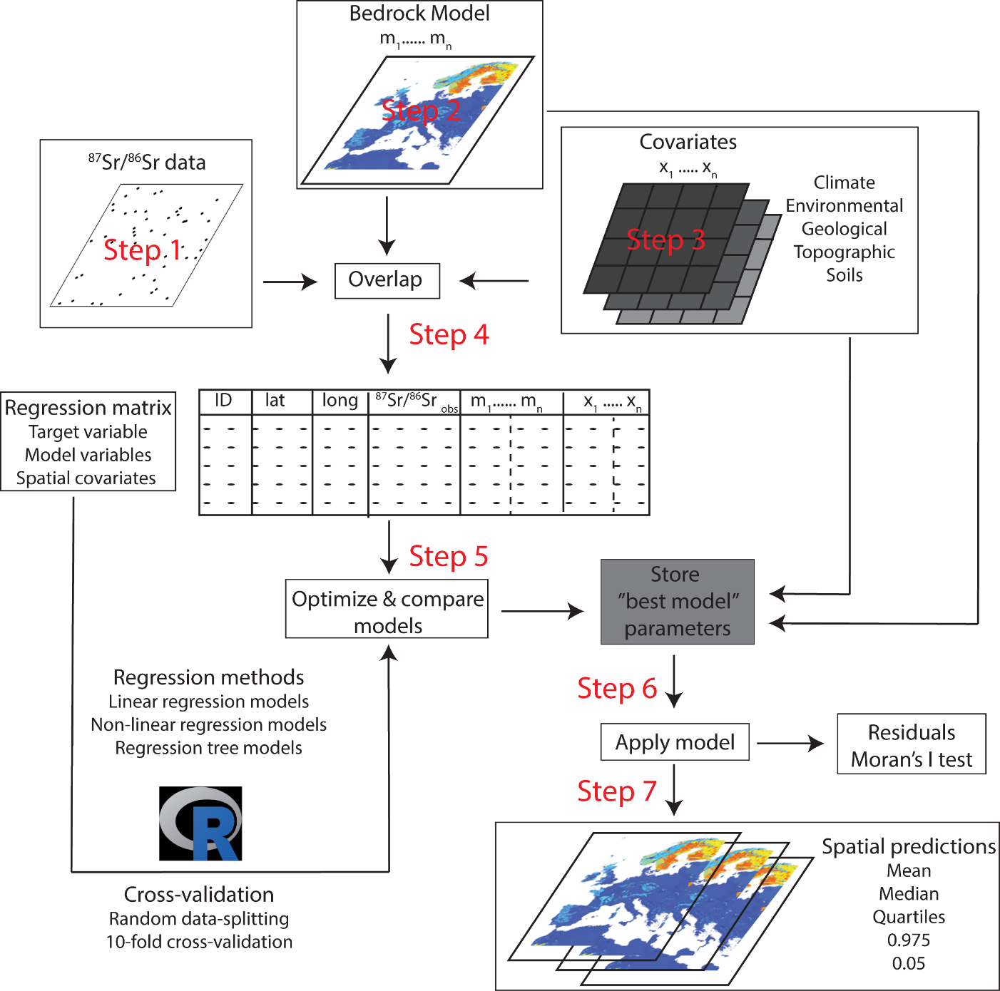

## Welcome

Welcome to Module 2 of our workshop, "Strontium isotope geolocation for terrestrial ecology," held at The 14th International Conference on the Applications of Stable Isotope Techniques to Ecological Studies (ISOECOL 2026) in Hong Kong!

In [Module 1](https://github.com/stantis/IsoEcolWorkshop2026), Chris showed how to screen bioavailable ⁸⁷Sr/⁸⁶Sr data with IsoBank and the ARDUOUS template. Today, we use a **different, already-cleaned dataset for South Africa** (not the one screened in Module 1) to build a **bioavailable ⁸⁷Sr/⁸⁶Sr isoscape** with random forest regression. In [Module 3](https://meganreich.github.io/Isoecol2026_Srworkshop_P3/), Megan will use this isoscape to find where painted lady butterflies came from.

::: {.callout-note appearance="simple"}
## How to use this site

Each section of the workshop has its own page, listed in the sidebar on the left. We'll go through them together, but you're welcome to work at your own pace. If you get lost, use the sidebar or the search box to find the section we're on.

Throughout the pages you'll find **Think · Pair · Share** breaks, marked with our "I ❤ strontium" tile {width="26" style="vertical-align:-6px" fig-alt="Strontium tile with a heart"}. Stop there, think on your own, discuss with your neighbour, then share with the room. Open the **"Things you might have noticed"** box only after the discussion!
:::

{width="75%"}

## What you'll learn

By the end of this module you will be able to:

-   Explain how a random forest builds a prediction from many decision trees
-   Build a regression matrix from bioavailable ⁸⁷Sr/⁸⁶Sr data and geospatial covariates
-   Choose covariates using process knowledge, and deal with correlated covariates
-   Select predictors and evaluate a random forest model with random and spatial cross-validation
-   Interpret variable importance and partial dependence plots
-   Map the isoscape and its uncertainty with a quantile random forest
-   Recognise the remaining limits of random forest isoscapes and how to address them

## Schedule

| Time          | Section                                                                      |
|---------------|------------------------------------------------------------------------------|
| In advance    | [Before the workshop](#before-the-workshop)                                  |
| 11:15 – 12:30 | [0. How random forest works](00-random-forest.qmd) · [1. Training data](01-training-data.qmd) · [2. Covariates](02-covariates.qmd) · [3. Regression matrix](03-regression-matrix.qmd) |
| 12:30 – 13:30 | Lunch (VSURF and the model run while we eat)                                 |
| 13:30 – 14:30 | [4. Cross-validation](04-cross-validation.qmd) · [5. Interpretation](05-interpretation.qmd) · [6. Isoscape](06-isoscape.qmd) · [7. Remaining issues](07-remaining-issues.qmd) |
| After the workshop | [Extra: applying this to your own study area](02b-own-study-area.qmd) |

## Before the workshop

::: callout-important
## Please set up before you arrive

1.  Install a recent version of [R](https://cran.r-project.org/).
2.  Install [RStudio Desktop](https://posit.co/download/rstudio-desktop/).
3.  Run the code below in the RStudio console to install the packages we'll use.
4.  **Download and unzip the workshop data and script** ([below](#get-the-data-and-the-script)). It is ~400 MB, so please do this at home: don't wait for the conference Wi-Fi!
5.  Open the project in RStudio and run the check at the end of this page ([below](#set-your-working-directory)).
:::

```{r}
#| label: install-packages
install.packages(c("terra", "sf", "rnaturalearth", "rnaturalearthdata", "caret", "VSURF",
                   "ranger", "corrplot", "viridis", "patchwork", "ggplot2", "pdp", "tidyverse"))
```

### Get the data and the script

1.  **[Download the workshop ZIP](https://github.com/cbataill/Isoecol2026_Srworkshop_P2/archive/refs/heads/master.zip)** (~400 MB). It contains this website's repository, including the data, the rasters and the script.
2.  **Unzip it** somewhere easy to find (e.g. your Desktop or Documents, not your Downloads folder, and not inside OneDrive/iCloud if you can avoid it). On Windows, right-click → **Extract All**: don't open files from inside the zip.
3.  Inside the unzipped folder `Isoecol2026_Srworkshop_P2-master`, the folder you need is **`Module2_isoscape`**. You can move it anywhere you like, as long as you keep its contents together.

The data are also on [PURR](https://purr.purdue.edu/projects/isoecol2026srwo/info). If you only want the script, [download `Script_RF_isoscape_SouthAfrica.Rmd`](files/Script_RF_isoscape_SouthAfrica.Rmd): every code chunk on this site comes from it.

### Folder organisation

```
Module2_isoscape/
├─ Module2_isoscape.Rproj   ← double-click this to start
├─ Script_RF_isoscape_SouthAfrica.Rmd
├─ Data/
│   └─ SouthAfrica_bioavailable_Sr_ARDUOUS.csv
├─ Project_Raster/
│   ├─ clipped_za/      (~60 rasters, Eckert IV, 1 km)
│   └─ neighbourhood/   (created by the script)
└─ Output/              (pre-computed results included)
```

### Set your working directory

All the paths in the code (`Data/...`, `Project_Raster/...`, `Output/...`) are **relative to the `Module2_isoscape` folder**. R must be "looking" in that folder, otherwise you'll get errors like `cannot open file 'Data/SouthAfrica_bioavailable_Sr_ARDUOUS.csv': No such file or directory`.

::: {.panel-tabset}
## Option A: RStudio project (easiest)

Double-click **`Module2_isoscape.Rproj`**. RStudio opens with the working directory already set to the right folder. Use this every time you come back to the workshop.

## Option B: from the script

Open `Script_RF_isoscape_SouthAfrica.Rmd` in RStudio, then **Session → Set Working Directory → To Source File Location**.

## Option C: setwd()

Type the path to *your* `Module2_isoscape` folder, with forward slashes `/` (also on Windows):

```{r}
#| label: setwd-example
setwd("C:/Users/yourname/Documents/Module2_isoscape")   # Windows
setwd("~/Documents/Module2_isoscape")                    # Mac / Linux
```

Tip: in RStudio, put the cursor between the quotes and press **Tab** to browse to the folder.
:::

**Then run this check.** It should print `TRUE` four times:

```{r}
#| label: check-wd
getwd()   # should end in .../Module2_isoscape
file.exists(c("Data/SouthAfrica_bioavailable_Sr_ARDUOUS.csv",
              "Project_Raster/clipped_za/r.srsrq1.tif",
              "Project_Raster/clipped_za/r.africa.Ca.0.tif",
              "Output/sr_agg_all.txt"))
```

::: {.callout-caution collapse="true"}
## I get FALSE or "cannot open file"

-   **`getwd()` doesn't end in `Module2_isoscape`:** R is looking in the wrong folder. Use one of the options above.
-   **It ends in `Module2_isoscape` but you still get `FALSE`:** check that you unzipped the whole folder (on Windows, files opened from inside a zip are not really there), and that `Data/` and `Project_Raster/` are directly inside `Module2_isoscape`, not one level deeper (e.g. `Module2_isoscape/Module2_isoscape/Data`).
-   **Only the rasters are `FALSE`:** the download was incomplete. Download the ZIP again.
:::

::: {.callout-tip icon="false"}
## Running the code

1.  Open the project (Option A), then open `Script_RF_isoscape_SouthAfrica.Rmd`.
2.  Run the setup chunk: it installs any missing packages.
3.  Run chunk by chunk (Ctrl+Shift+Enter on Windows, Cmd+Shift+Enter on Mac) and look at each output. You can also copy the code from this site into the console, as long as the working directory is set.
4.  Keep this website open next to RStudio. The script tells you where to look: **📖** lines name the matching page of the website, and **🛑 STOP** lines mark the Think · Pair · Share breaks, with a direct link to the discussion questions.

The whole script takes ~15–20 min on a laptop. The two slow steps are VSURF (~8 min, [Step 4.3](04-cross-validation.qmd#step-4.3-predictor-selection-with-vsurf)) and the isoscape prediction (~5 min, [Step 5.2](06-isoscape.qmd)). If your laptop is slow, load the pre-computed results from `Output/`.
:::

::: {.callout-note appearance="simple"}
The figures on this site come from a pre-computed run of the script. Your results should be very close, but small differences are normal (random seeds, package versions).
:::

## More resources

-   Bataille, C. P., Crowley, B. E., Wooller, M. J., & Bowen, G. J. (2020). Advances in global bioavailable strontium isoscapes. *Palaeogeography, Palaeoclimatology, Palaeoecology*, 555, 109849. <https://doi.org/10.1016/j.palaeo.2020.109849>
-   Global predictor rasters (Eckert IV, 1 km): <https://osf.io/a2r7g/>
-   ARDUOUS template: <https://www.nature.com/articles/s41597-026-06643-3>
-   ARDUOUS dataset: <https://doi.isoarch.org/10.48530/isoarch.2024.002>

## Getting help

During the workshop, put up your hand or ask Clement, Megan, or Chris for help. Code that does not run? Compare with your neighbour first, then ask. Afterwards, contact Clement Bataille (Purdue University).

# **Start:** [0. How random forest works →](00-random-forest.qmd)
